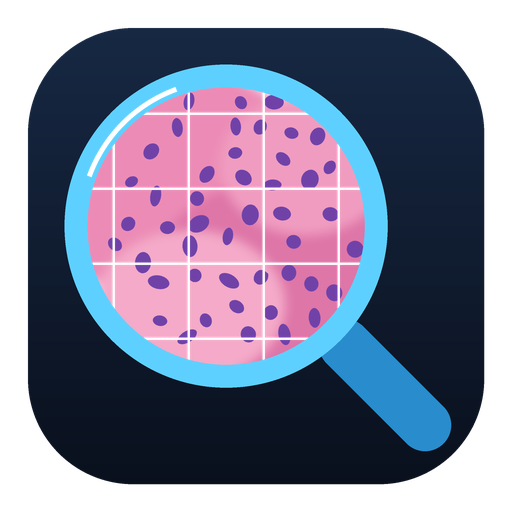
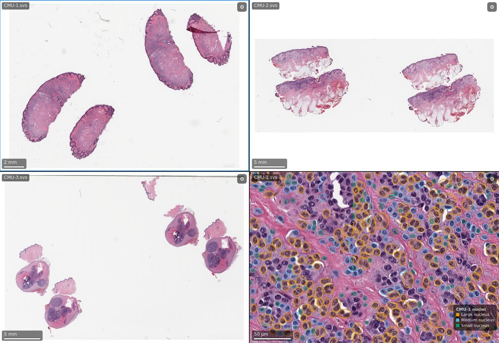
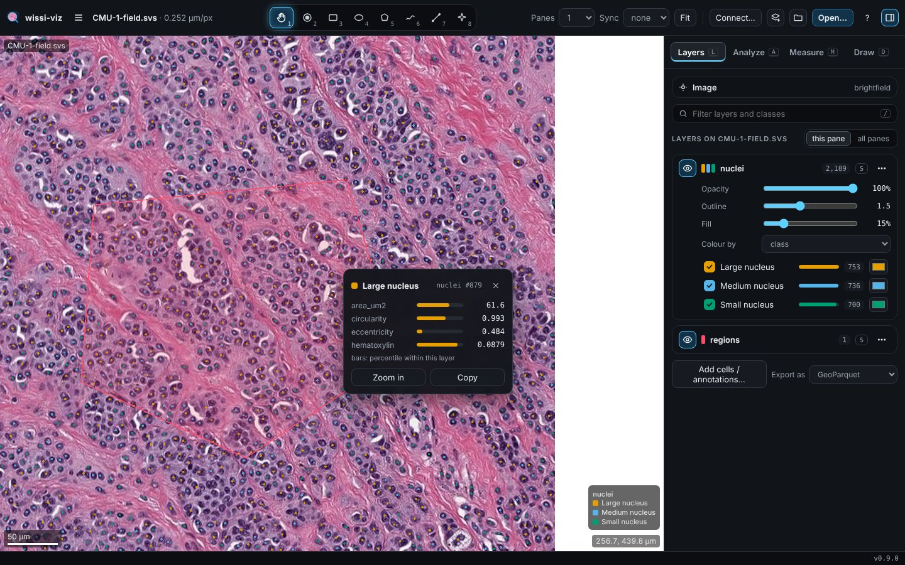
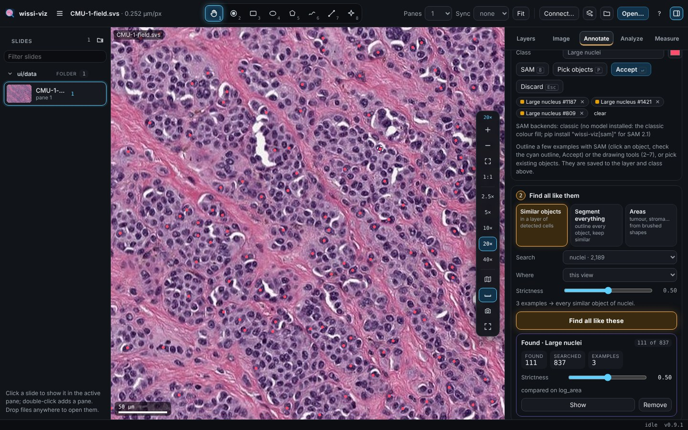
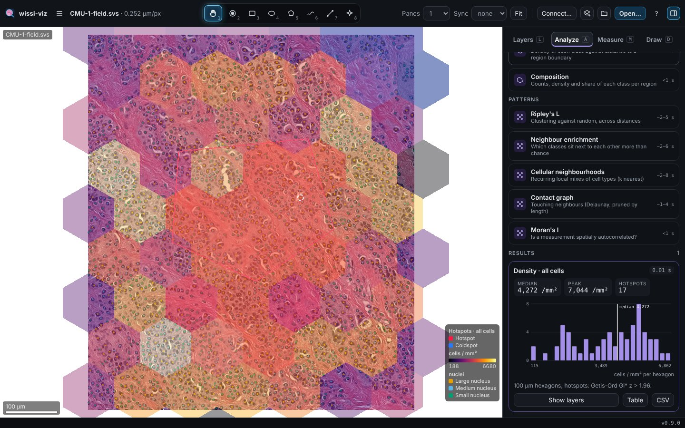
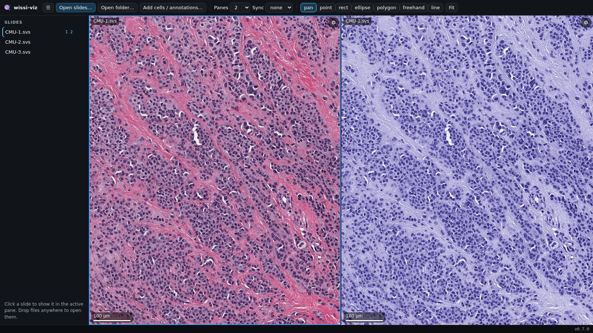
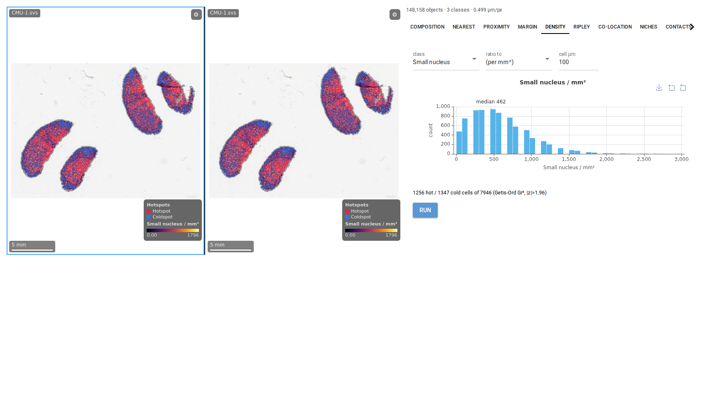

<p align="center">
  
</p>

<h1 align="center">wissi-viz</h1>

<p align="center">
  GPU whole-slide image viewer and spatial-analysis toolkit for brightfield and fluorescence histology.<br>
  Embed it in any web app, use it inside NiceGUI, or run it as a desktop app.
</p>

<p align="center">
  <a href="https://github.com/zaloch/wissi-viz/actions/workflows/ci.yml"></a>
  
  
  <a href="LICENSE"></a>
</p>

<p align="center">
  <a href="https://zaloch.github.io/wissi-viz/">Website</a> ·
  <a href="docs/GUIDE.md">Guide</a> ·
  <a href="docs/INTEGRATION.md">Integration</a> ·
  <a href="benchmarks/README.md">Benchmarks</a>
</p>



<sub>Screenshots use real slides from the [OpenSlide test data](https://openslide.cs.cmu.edu/download/openslide-testdata/Aperio/) (CMU-1, CMU-2, CMU-3; CC0 1.0). The 148k nuclei above were detected on CMU-1 by `scripts/make_screenshots.py`; the app screenshots below show a 0.64 × 0.73 mm field of CMU-1 with the 2,189 nuclei detected in it.</sub>

## Features

- **Fast, on the GPU.** One WebGL2 context drives 1–32 panes, with synchronised navigation, multi-channel fluorescence compositing, stain deconvolution and adaptive resolution while moving. It stays smooth on clients without a GPU.
- **Formats:** SVS, CZI, OME-TIFF, NDPI, VSI, ZVI, DICOM, SCN, AFI and more, plus vendor tile APIs (PathCore, HALO Link, any HTTP tile service) through connectors.
- **Millions of cells.** Object tables from QuPath, HALO, CellProfiler, GeoJSON, label masks or AnnData. They are shown as aggregated dots when zoomed out and as GPU-drawn outlines up close, coloured by class or by any measurement.
- **Annotations with SAM 2.1, built in.** Click an object or drag a box in any of the 32 panes and Segment Anything outlines it; pick a class and accept. SAM 2.1 tiny (int8, 33 MB) ships with wissi-viz and runs on ONNX Runtime (CPU, CUDA, DirectML): no extra, no download, offline. PyTorch with the larger models is optional (`[sam]`). Drawing tools too (point, rectangle, ellipse, polygon, freehand, line).
- **Find all like these.** Mark a few examples (SAM, drawing, or picking objects) and find every similar one in the
  view, a region or the whole slide: similar objects of a cell layer, *segment everything* with SAM and keep the
  similar, or a pixel classifier for areas (tumour, stroma, …). Or **by text**: type “nucleus” or “gland. vessel” and
  Grounding DINO + SAM 2.1 (Apache-2.0) outline every match, or SAM 3 (opt-in, under Meta's SAM License, which the
  app shows before downloading it). Background jobs with progress, cancel and a live strictness slider.
- **An efficient annotation format.** GeoParquet (≈3× smaller than GeoJSON, spatially filterable, opens in GeoPandas, QGIS and DuckDB), with `wissi-viz convert` to and from QuPath GeoJSON, HALO, Aperio and ASAP XML, CSV, COCO and label masks.
- **Measurements of any region.** Shape, stain or channel intensity, texture, and — with cells — counts, density, composition, diversity, neighbour distances, contacts and clustering (Clark–Evans, Morisita, Ripley), per class, in one exportable table.
- **Spatial analysis:**
  - nearest neighbours, proximity, invasive margins, ROI composition, density and hotspots;
  - Ripley's K/L/g, co-location, cellular neighbourhoods, contact graphs, Moran's I, IHC H-score.
  - Each analysis produces a table, a slide overlay and a chart, from Python or from the app's **Analyze** tab.
- **An app with an inspector.** The desktop app, `wissi-viz serve` and NiceGUI's `WissiApp` share one interface: a
  slide list grouped into projects and folders, a tool bar, a view bar on the slide (zoom, magnifications, overview
  map, scale bar, snapshot), and an inspector that follows the active pane (Layers, Image, Annotate, Analyze,
  Measure). Per-channel histograms for fluorescence, per scene for CZI. Click a cell for its measurements and where
  it ranks in its layer; right-click for actions under the cursor; `?` lists the keys.
- **Built for servers:** memory and disk tile caches with byte budgets, memory-mapped object layers, an integration probe and a load tester.
- **Permissive licences only.** The default install is BSD / MIT / Apache-2.0 / ISC, and a test enforces it. LGPL readers are an opt-in extra; SAM 3 (SAM License) is never installed, only downloaded after you accept its licence.

## Install

```bash
uv add "wissi-viz[nicegui,server]"      # in your project (or: pip install "wissi-viz[nicegui,server]")
uv tool install "wissi-viz[desktop]"    # the desktop app
```

**Try it on real slides** — the bundled demo downloads public images (CC0, TCGA open access, CC BY), finds every
cell, runs the analyses and opens them; the benchmark measures this machine:

```bash
uv run wissi-viz --demo              # needs the [demo] extra · asks: quick or full
uv run wissi-viz --demo quick        # 5 images (~1.2 GB): 3 H&E + 2 multiplex IF
uv run wissi-viz --demo full         # 32 images (~7 GB): 26 H&E (18 tumour types, lymph-node metastases) + 6 IF
uv run wissi-viz --benchmark         # report → ./wissi-viz-benchmark.md
```

| Extra | Adds |
|---|---|
| `nicegui` | the NiceGUI element |
| `server` | uvicorn, for `wissi-viz serve` |
| `analysis` | spatial statistics (scipy, shapely, scikit-image, pandas) |
| `io`, `polars` | Parquet / Arrow / AnnData readers |
| `slideio` | VSI, ZVI, DICOM, SCN, AFI |
| `remote` | HTTP client for vendor tile APIs |
| `desktop` | the native desktop window (pywebview) |
| `sam` | SAM 2.1 on PyTorch with the larger models (the bundled tiny model on ONNX Runtime needs no extra) |
| `all` | everything permissive above, except `desktop` |
| `lgpl` | opt-in: OpenSlide (MRXS, BIF) and libCZI |

wissi-viz runs on Windows, macOS (Apple silicon and Intel) and Linux (x86_64, ARM), with Python 3.10–3.14. On a
network that inspects HTTPS (corporate), add `--system-certs` to any command (or set `WISSI_VIZ_SYSTEM_CERTS=1`).

## Quick start

**Desktop app.** Open slides and cell tables from your disk:

```bash
wissi-viz-app                              # File ▸ Open slides…, or drop files on the window
wissi-viz desktop slide.svs cells.csv      # or open files from the command line
wissi-viz desktop --install-shortcut       # add it to the Start menu / Applications / app menu
wissi-viz desktop --connect my_api.json    # images from a tile API (or: Connect… in the app)
```



**The inspector**, beside the slide (keys in brackets):

| Tab | What it does |
|---|---|
| **Layers** (`L`) | nested, by source (drawn & SAM · found · detected · analysis · imported) or flat; per layer: show / hide (`H`), solo (`S`), opacity, outline, fill, colour by class or any measurement, class toggles with counts and colours, zoom / export / summary / remove; hovering a row pulses its objects on the slide |
| **Image** (`I`) | histograms of the whole image, the view or a CZI scene; per fluorescence channel: drag min / max, gamma, colour, solo, auto; link channels; brightfield levels, stain view |
| **Annotate** (`D`) | ① examples: SAM, drawing tools, or pick objects (`P`); ② find all like them: similar objects, segment everything, areas, or by text (Grounding DINO + SAM 2.1, or SAM 3 opt-in) |
| **Analyze** (`A`) | density & hotspots, nearest neighbours, proximity, margin bands, infiltration, composition, Ripley's L, neighbour enrichment, cellular neighbourhoods, contact graph, Moran's I: each run adds layers to the slide and a card with numbers, a chart, the table and a CSV |
| **Measure** (`M`) | count, share and averages per class, cells per mm² of tissue, region areas; shape, intensity, texture and cell statistics for every region |

Tools are on keys `1`–`8` (pan, point, rectangle, ellipse, polygon, freehand, ruler, SAM); the view bar on the slide
zooms to 2.5–40×, shows the overview map (`O`), toggles the scale bar and saves a snapshot; the footer shows frames
per second. Click an object for its card, right-click for a radial menu, `?` for every shortcut.





**Segment, convert, measure:**

```bash
wissi-viz segment slide.svs cells.parquet --model cellpose   # every cell → GeoParquet (Cellpose-SAM, GPU)
wissi-viz convert cells.parquet cells.geojson --to qupath    # or halo / aperio / csv / coco / mask
```

**Standalone server** with the same app UI (slide list, 1–32 panes) for everyone on your network:

```bash
wissi-viz serve /data/slides --port 8010
# open http://127.0.0.1:8010/   (the bare element demo is at /demo)

wissi-viz serve --allow-open /data/slides --key s3cret   # visitors pick and open slides from that folder
wissi-viz serve --connect my_api.json --images A1,A2     # images from a tile API (HALO Link, PathCore, OMERO, …)
wissi-viz serve --allow-connect --key s3cret             # visitors may connect it to tile APIs themselves
```

A tile API is described in a small JSON file: base URL, auth header, where the image list, metadata and tiles are
([guide §7](docs/INTEGRATION.md#7-connecting-a-tile-api-pathcore-halo-link-)). Services without plain tile URLs use
your own connector class: `--connect mypkg.halo:make_connection`.

**As an HTML element in any page or framework:**

```html
<script type="module" src="/wissi-viz/static/index.js"></script>
<wissi-viz api="/wissi-viz" slides="case1,case2"></wissi-viz>
```

**Inside a NiceGUI app** — the whole app (inspector included) in a page, or the viewer element under your own
controls:

```python
from nicegui import ui
from wissi_viz.nicegui import WissiApp, WissiViz, configure

configure(cache_dir='/var/cache/wissi-viz')  # once, at startup


@ui.page('/')
def index():
    WissiApp(['/data/case1.svs', '/data/case1_cells.parquet']).style('height: 90vh')


@ui.page('/custom')
def custom():
    grid = WissiViz(['/data/case1.svs', '/data/case1_if.czi'], sync='all').classes('w-full h-[85vh]')
    ui.button('20×', on_click=lambda: grid.go_to('all', 15200, 9800, magnification=20))


ui.run()
```

Your own panels get the same pieces in Python: `await grid.summary(...)`, `await grid.run_analysis(...)`,
hover / right-click / layer events and `analyses.echarts_option(...)` for `ui.echart`. See
[integration §2](docs/INTEGRATION.md#2-nicegui-path-a) and `examples/nicegui_inspector.py`.

**Stain deconvolution and spatial analysis:**




## Documentation

| | |
|---|---|
| [Guide](docs/GUIDE.md) | features in depth: annotations, objects, spatial analysis, navigation API, caching, level of detail, licences |
| [Integration](docs/INTEGRATION.md) | NiceGUI, ASGI apps, separate tile servers, iframes, vendor connectors, security, deployment, the desktop app, platforms |
| [Load testing](docs/LOAD_TESTING.md) | simulating 10–100 users and estimating capacity |
| [Benchmarks](benchmarks/README.md) | measured results: panning, zooming, overlays, tile APIs, memory |

## Development

```bash
git clone https://github.com/zaloch/wissi-viz && cd wissi-viz
uv sync --extra all                         # every permissive extra (PyTorch included); not --all-extras: that adds LGPL
uv run playwright install chromium
uv run pytest -q
uv build
uvx ruff check . && uvx ruff format .   # lint + format (settings in pyproject.toml)
```

Code style: ruff (pycodestyle, pyflakes, isort, bugbear, pyupgrade, comprehensions, blind excepts), 120 columns,
single quotes. Imports go at the top of the module; only optional extras (torch, cellpose, pandas, …) are imported
inside the function that needs them, so `import wissi_viz` works with the core install. `tests/test_style.py`
enforces this, and every `except Exception` carries a comment saying why it is safe.

CI lints first, then runs the tests on Linux (x64, ARM), Windows and macOS (Apple silicon, Intel) for Python 3.10, 3.12 and 3.13.

## License

[MIT](LICENSE) © G. Zeballos. Dependency licences are listed in the [guide](docs/GUIDE.md#licences).
