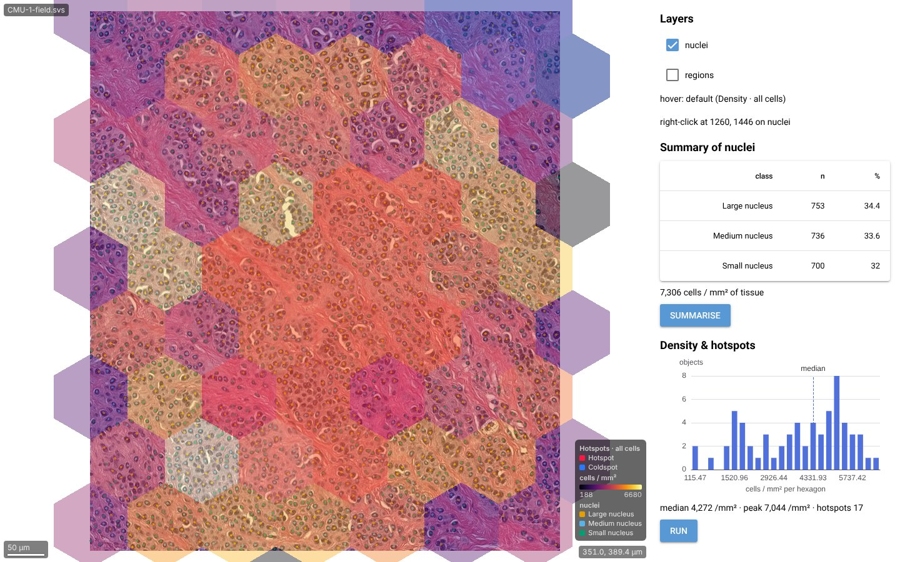

# Integrating wissi-viz

*Current as of wissi-viz 0.13.0.* This guide covers how to put wissi-viz into an app: NiceGUI (wissi), other Python web frameworks, JavaScript frameworks and notebooks. It also covers:
- how to show large cell and object tables;
- how to keep the viewer smooth, including on clients without a GPU;
- how to connect a vendor tile API such as PathCore or HALO Link;
- how to deploy and load-test;
- the standalone desktop app, and installing with uv on Windows, macOS and Linux;
- annotation files, SAM 2.1 click annotation, region measurements, and the public demo and benchmark.

```
 browser (any app)                       your server                                   storage / vendors
┌───────────────────────┐   HTTP(S)   ┌──────────────────────────────────┐        ┌───────────────────────┐
│ <wissi-viz> (WebGL2)  │◀──────────▶│ wissi-viz router (/wissi-viz/…)   │──read──▶│ SVS/CZI/OME-TIFF files │
│ GPU: tiles, channels, │  tiles,     │  memory + disk tile cache         │        └───────────────────────┘
│ stains, cell overlays │  overlays   │  compiled object-layer cache      │        ┌───────────────────────┐
└───────────────────────┘             │  SlideRegistry                    │──HTTP──▶│ PathCore / HALO Link / │
                                      │   ├ file sources                  │  token  │ any tile API          │
                                      │   └ RemoteConnection (your code)  │        └───────────────────────┘
                                      └──────────────────────────────────┘
```

- **GPU work happens in the browser.** The server decodes and caches tiles and object layers on the CPU and needs no GPU.
- **The browser never talks to the vendor API.** Tiles flow API → wissi-viz cache → browser, so vendor tokens stay on your server and repeat views make no upstream requests.

**What's new since 0.4** (details in the sections below):

| Version | Change | What you do |
|---|---|---|
| 0.8.0 | **Annotate, measure, demo.** Up to 32 panes; `wissi-viz serve` shows the app UI with a slide list. SAM 2.1 click / box annotation (PyTorch or ONNX Runtime, Apache-2.0 weights). GeoParquet annotation files and `wissi-viz convert`. Region and object metrics. `wissi-viz segment` (Cellpose-SAM, Classpose, classic). `wissi-viz --demo` / `--benchmark` on 32 public slides. | Optional: `[sam]` / `[sam-onnx]` extras (§15); `[demo]` for the demo (§17). Pages that loaded `/` for the bare element demo now use `/demo`. |
| 0.9.0 | **Inspector.** The app's Layers / Analyze / Measure / Draw inspector, object cards with percentiles, hover tips, a radial menu and keyboard shortcuts (§12). Spatial analyses from the app and `wissi_viz.analyses` (§16). Layer summaries, colour-by and removal over HTTP. NiceGUI: `WissiApp` / `mount_app` (the whole app in a page), `on_object_hover` / `on_context` / `on_layers`, `flash_layer`, `summary`, `run_analysis`, and `analyses.echarts_option` for `ui.echart` (§2). **Connect…** and `--connect` for tile APIs (§7); `serve --allow-open` with an in-page file picker and `--key` (§8). | The app page's logic moved to `static/app.js`. The per-pane ⚙ menu is off in the app (its controls are in the inspector); the element keeps it. New viewer events: `objecthover`, `panecontext` (opt-in: `grid.hoverEvents`, `grid.contextEvents`) and `layers`; new methods `hitAt()` and `flashLayer()`. NiceGUI handlers now run once per event (they also ran a second time without the event's data). |
| 0.9.1 | `--system-certs` / `WISSI_VIZ_SYSTEM_CERTS=1`: downloads trust the operating system's certificates, for networks that inspect HTTPS (§13). | Nothing; use the flag where downloads fail with `CERTIFICATE_VERIFY_FAILED`. `truststore` (MIT) is a new core dependency. |
| 0.10.0 | **Find all, image tools, projects.** Annotate tab: examples (SAM, drawing, picked objects) → find all like them: similar objects, segment everything (SAM / classic) or areas (pixel classifier), in the view, a region or the whole slide, as background jobs with progress, cancel and a live strictness slider (§12, `wissi_viz.findall`, §16). Image tab: histograms of the whole image, the view or a CZI scene, with draggable windows, auto, link, solo. View bar on the slide (zoom, 1:1, 2.5–40×, overview map, scale bar, snapshot, full screen) and an FPS readout. Layers: nested / by source / flat views and source badges (`origin`, saved with layers). Slide list: projects and folder groups. In-page file picker with places, a path bar, multi-select and Open this folder (also in a browser window). `--demo` asks quick or full. | `scikit-learn` (BSD-3) joins the `analysis` extra. Layers you draw are tagged drawn / sam. The scale bar now shows after a pane change (it stayed hidden). Channel auto-contrast reads a finer level (bright structures saturated before). In the in-page picker a click selects; double-click or Open opens. The Draw tab is now Annotate (same key, `D`). |
| 0.12.0 | **Find by text.** Annotate → Find all → By text: name what to find and every match is outlined, by Grounding DINO + SAM 2.1 (Apache-2.0, downloaded once from this project's release) or SAM 3 (opt-in under Meta's SAM License, shown and accepted in the app before anything is downloaded) (§15, `findall.find_by_text`, `wissi_viz.grounding`, `wissi_viz.sam3`). Find-all results can hold several classes (one per phrase). *Then find all like the best matches*: confident text matches become examples for segment everything. **Chains and batches**: Make regions… / Keep only inside… (a layer's menu), Only inside (any analysis, on the cells inside a region layer), Run on all images or a project (one table, a row per image) (§16, `wissi_viz.layerops`, `analyses.run_batch`). | ONNX Runtime no longer picks CoreML on macOS (it compiled SAM's graphs for minutes; CPU is used instead). New endpoints `GET`/`POST {prefix}/models/sam3/license`. Segment everything enlarges tiles so SAM sees each object ~40 px across (nuclei on a 0.5 µm/px H&E were ~16 px: 6× more of them are now outlined on CMU-1), keeps per click the best-scored of SAM's masks that has the object's size, and drops masks cut by a tile's edge (each is found whole in the overlapping tile). `[all]` is now every permissive extra (desktop, remote, bench and sam too): `uv sync --extra all`. **Awkward files** (`tests/test_edge_cases.py` runs each through opening, tiles, histograms, tissue, measuring, SAM, segment everything and every export): Philips TIFF resolution is read (CAMELYON16); layers keep the µm/px they were made at; analysis without any resolution assumes 0.5 µm/px and says so; float and 32-bit channels are scaled from their range (they read as 0) and 16-bit RGB is scaled to 8 bit (it wrapped); empty, truncated and non-slide files are refused at once with a plain reason; invalid shapes (NaN coordinates, fewer than 3 points) are left out and counted instead of breaking the layer; table rows without a valid position are left out; numeric class names work; downloads of slides with non-ASCII names work; dropped sample-pack downloads resume. Model downloads are checked against the release's SHA-256 sums. |
| 0.13.0 | **Cells in Find all.** Annotate → Find all → By text → Model has a second group, *Cells and nuclei*: Cellpose-SAM (`[cells]` extra), the classic stain threshold (no model) or Classpose (whole slide files, via uv) outline every nucleus of the view, a region or the slide into a *detected* cell layer with classes and measurements, which the analyses use; no prompt needed. They read the slide's tiles, so they work on tile-API slides (HALO and other connectors) too, which `wissi-viz segment` cannot (§15, `findall.find_cells`, `segment.segment_source`). **SAM 3 is downloadable**: the release `sam3-onnx-v1` is built from the public float32 export when there is no Hugging Face access to Meta's checkpoint; until a version's download is published the app says so instead of failing (`sam3.status()['published']`). | Nothing. `pip install "wissi-viz[cells]"` for Cellpose-SAM: opt-in and not in `[all]`, since Cellpose requires fill-voids (LGPL-3.0). |
| 0.11.0 | **SAM 2.1 built in.** SAM 2.1 tiny (int8 ONNX, 33 MB) ships inside the package and ONNX Runtime is a core dependency: click / box annotation and *segment everything* use SAM without extras, downloads or a GPU (§15). | ONNX Runtime, SciPy and scikit-image are now core dependencies (all permissive; ~24 MB wheel). `WISSI_SAM_MODEL` defaults to the bundled tiny on onnx (`small` / `tiny-fp32` download float32 exports). Intel Macs on Python 3.14 have no ONNX Runtime wheel and keep the classic fill. On a GPU, replace onnxruntime with onnxruntime-gpu. |
| 0.7.0 | **Desktop app and platform support.** `wissi-viz-app` opens the viewer in its own native window with its own icon (pywebview), as an option next to the embedded element. Windows, macOS and Linux are supported and CI-tested; packaging moved to uv (`uv.lock`, dependency groups). Python 3.10–3.11 work again (older czifile). | Nothing for embedded use. For the app: `uv tool install "wissi-viz[desktop]"` (§12). For development: `uv sync` (§13). |
| 0.5.0 | **Object pyramid.** Millions of cells are shown as screen-sized aggregated dots, then as GPU-drawn outlines when zoomed in. There is a **server mode** (default) and a **client mode**. | Use `cached_object_layer` for big tables (§5). Choose `overlays: 'server'\|'client'\|'auto'`. |
| 0.5.1 | **Polars reader.** `read_objects(engine='auto')` uses Polars, then pyarrow, then pandas. | `pip install "wissi-viz[polars]"`. |
| 0.6.1 | **Server memory stays flat.** Annotation and object layers from connectors were kept in RAM for every slide ever opened, so a PathCore-backed server grew without limit. They are now memory-mapped from the disk cache and evicted least-recently-used, every cache has a byte budget, and `/wissi-viz/stats` reports where memory is. | Set `cache_dir` (it now also holds compiled layers). Optionally tune the budgets (§6, §9). |
| 0.6.0 | **Integration probe + HTTP config connector.** `scripts/wissi_probe.py` smoke-tests a connector, sweeps concurrency, runs 1–16-pane viewer sessions under a hard API-call cap, and writes recommended settings. `HttpTileConnection` connects tile APIs with plain tile URLs from a JSON file. | Run the probe before go-live (§10). |
| 0.5.2 | **Smoothness.** Adaptive resolution while moving, culled cell outlines, a batched `views` event, and frame-cost-aware redraws. | Use the `views` event, never update the page per frame (§6). `on_view_change` now comes from the batched event. |

## 1. Choose an integration path

| Path | Use it when | Python control | Tested here |
|---|---|---|---|
| **A. NiceGUI** — the whole app (`WissiApp`) or the element (`WissiViz`) under your own controls | your app is NiceGUI (wissi) | full: navigation, layers, summaries, analyses, events | ✔ `examples/nicegui_inspector.py` end to end (`tests/test_nicegui.py`) |
| **B. Web component in a NiceGUI page** | you prefer to drive it from JavaScript | `ui.run_javascript` | ✔ (same component) |
| **C. Same server, any ASGI app** (FastAPI, Starlette, Litestar) | one Python service | your own endpoints | ✔ `create_router` / `create_app` |
| **D. Separate tile server + `<wissi-viz>` in any page** (React, Vue, Svelte, Django or Flask templates, Streamlit, Dash, static HTML) | non-Python front ends, WSGI apps, or scaling tiles separately | over HTTP | ✔ cross-origin test (`tests/test_browser.py`) |
| **E. iframe** of a viewer page | maximum isolation, minimum integration | `postMessage` | — |
| **F. Desktop app** `wissi-viz-app` | people open local files, no web app needed | — (it is the app) | ✔ `tests/test_desktop.py` |

```bash
uv add "wissi-viz[nicegui,polars]"            # in a uv project (or: pip install …); same extras below
pip install "wissi-viz[nicegui,polars]"       # path A/B; add [server] for C/D, [remote] for vendor APIs, [analysis] for spatial stats
pip install "wissi-viz[all]"                  # everything permissive (BSD/MIT/Apache), PyTorch and the desktop window included; LGPL readers are opt-in: [lgpl]
```

## 2. NiceGUI (path A)

Two ways in, which mix freely: they share one registry, so slides and layers loaded through either are available to both (an open `WissiApp` page picks up layers added from Python when it reloads).

| | `WissiApp` — the whole app | `WissiViz` — the viewer element |
|---|---|---|
| What you get | slide list, tool bar, inspector (Layers / Analyze / Measure / Draw), object cards, radial menu, shortcuts: the desktop app's interface | 1–32 panes and nothing else; you build the controls in NiceGUI |
| How it is drawn | an iframe of the app page, served by NiceGUI's own server under `/wissi-app` | a NiceGUI element |
| Python control | which slides and layers it shows; it is otherwise self-contained | everything: navigation, layers, events, summaries, analyses |
| Use it when | users need the full workbench now | the viewer is one part of your own workflow |



### The whole app: `WissiApp`

```python
from nicegui import ui
from wissi_viz.nicegui import WissiApp, configure, mount_app

configure(cache_dir='/cache/wissi-viz')  # tiles under /wissi-viz
mount_app('/wissi-app')  # the app page; open_dirs=[...] lets users browse, dependencies=[...] adds your login check


@ui.page('/workbench')
def workbench():
    ui.query('.nicegui-content').classes('p-0 gap-0')  # edge to edge
    WissiApp(['/data/case1.svs', '/data/case1_cells.parquet'], tab='analyze').style('height: 100vh')
```

- **Slides:** paths or registered slide ids, 1–32 panes. Cell tables (CSV, Parquet, AnnData…) and annotation files in the list attach to the first slide. `tab` picks the inspector tab it opens on.
- **`mount_app(path, registry=None, open_dirs=None, allow_connect=False, key=None, dependencies=None)`** serves the page once per process and returns its `Session`: `session.open([...], trusted=True)` and `session.add_layer(slide, file)` load anything the app can open (cell tables included). `WissiApp` mounts it on first use if you haven't.
- **What users can open themselves:** nothing outside your list unless you pass `open_dirs` (an in-page file picker limited to those folders) or `allow_connect=True` (tile APIs). The same rules as `wissi-viz serve` (§8).
- **Login:** pass the same `dependencies=[Depends(require_login)]` to `configure` and `mount_app` (see the next example for `require_login`).
- **Behind a reverse proxy with a path prefix,** tell the iframe where it is: `WissiApp([...], url_prefix='/myapp')`. The page itself works under any mount path.

### The element under your own controls: `WissiViz`

```python
from fastapi import Depends, Request, HTTPException
from nicegui import ui
from wissi_viz import cached_object_layer
from wissi_viz.nicegui import WissiViz, configure


def require_login(request: Request):  # your auth; protects every tile and overlay route
    if not request.session.get('user'):
        raise HTTPException(401)


registry = configure(cache_dir='/cache/wissi-viz', memory_mb=2048, dependencies=[Depends(require_login)])


@ui.page('/viewer')
def viewer():
    grid = WissiViz(
        ['/data/case1.svs', '/data/case1_if.czi'],
        layout='1x2',
        sync='all',
        on_object_click=lambda e: ui.notify(e.get('properties')),
        on_view_change=lambda v: status.set_text(f'pane {v["pane"]}: {v["magnification"]:.1f}×'),
    ).classes('w-full h-[85vh]')
    status = ui.label()
    cells = cached_object_layer('/data/case1_cells.parquet', '/cache/layers', mpp=0.25)  # see §5
    grid.show(grid.slides[0], cells, name='cells')
    with ui.row():
        ui.button('ROI 1', on_click=lambda: grid.go_to(0, 15200, 9800, magnification=20))
        ui.button('All → 1.2 mm, 0.8 mm', on_click=lambda: grid.go_to('all', 1200, 800, units='um', fov_um=500))
        ui.button('4×4', on_click=lambda: grid.set_layout('4x4'))
```

| Python call | Effect |
|---|---|
| `WissiViz(slides, layout=, sync=, controls=, legend=, tool=, quality=, texture_budget_mb=, lod=, on_…=)` | create a viewer. `lod` takes `'default'`, `'legacy'` or a dict of options (§6). |
| `set_slides([...])`, `set_slide(i, ref)` | 1–32 panes. A ref is a path, a registered slide id, a `SlideSource` or `{slide, view, channels, layers}`. |
| `go_to(pane, x, y, units='px'\|'um', magnification=…\|zoom=…\|fov=…\|fov_um=…)`, `go_to_bounds`, `go_to_object`, `fit`, `set_active` | navigation; `pane` = index, `'active'`, `'all'` or a list |
| `set_layout('auto'\|'RxC')`, `set_sync('none'\|'all'\|'pan'\|'zoom')`, `set_tool(tool, draw_layer=)` | grid layout, linked navigation, drawing tools |
| `set_channel(pane, i, visible=, color=, min=, max=, gamma=)`, `set_adjust(...)`, `set_stain(pane, mode)`, `await auto_stain(pane)` | display |
| `show(slide, result_or_table_or_layer, group=…, replace=…)`, `add_annotations(slide, layer_or_path)` | overlays; every viewer showing that slide refreshes |
| `set_layer_visible`, `set_layer_style`, `set_class_visible`, `select` | layer control |
| `set_lod(preset)` or `set_lod(motion_bias=…, adaptive=…, overlays=…)` | level of detail and overlay mode (§6) |
| `grid.views` (dict pane → view, kept current), `await get_views()` | where every pane is looking (px and µm) |
| `on_view_change` | called with `{pane, x, y, zoom, mpp, magnification, bounds}` for each pane that moved. It is driven by one batched `views` snapshot, at most about 6 per second, and the final view is always delivered. |
| `on_click`, `on_object_click`, `on_draw`, `on_slide_load` | other Python callbacks (`paneclick`, `objectclick`, `draw`, `slideload` events) |
| `on_object_hover`, `on_context`, `on_layers` | the object under the pointer (`{pane, layer, index, class, color, size}` or `None`; throttled to 10/s), a right-click (`{pane, slide, x, y, object}`), a slide's layer list changing (`{slide, names}`). Hover and right-click events are only sent when you pass a handler. |
| `flash_layer(pane, layer)` | make a layer's objects pulse (e.g. when its row in your own list is hovered) |
| `await summary(slide, layer, tissue=True)` | count, share and per-class means, numeric columns, region areas, tissue mm² and objects per mm² (`wissi_viz.summary`) |
| `await run_analysis(slide, analysis, objects, **params)` | one of the app's analyses (`wissi_viz.analyses.catalog()`); result layers appear on every viewer of the slide. Returns `{title, kpis, note, layers, chart, table, seconds}`. |
| `refresh_annotations(slide=None)` | re-fetch layer lists after changing layers yourself (registry changes do it already) |

**Notes**
- **Keep the main loop free.** `on_view_change` is throttled, but it should still be cheap. Don't push a large UI update from it (re-render a table, redraw a chart): debounce until the view rests. See §6.
- **Shared state:** the registry and its caches are per process and shared by all users. Use per-user slide ids if users must not see each other's annotation edits.
- **Paths:** routes mount on NiceGUI's own FastAPI app, so there is no extra port. Reverse-proxy subpaths (`window.path_prefix`) work.
- **Analysis, two levels:**
  - The app's analyses, one call: `out = await grid.run_analysis(slide, 'nn', 'cells', source='CD8', target='Tumor')`, then `ui.echart(analyses.echarts_option(out['chart']))` and `ui.table(columns=…, rows=…)` from `out['table']`. Parameters and their limits are in `analyses.catalog()`, so you can build forms from it.
  - Full control: call `wissi_viz.spatial` yourself (`res = spatial.nearest_neighbors(objs, 'CD8', 'Tumor')`), show `ui.echart(res.plot())` and `grid.show(slide, res)`. See `examples/analysis_app.py`.
- **Your own analysis in the app:** decorate a function with `@analyses.analysis(key, name, group, description, params)` before the page loads; it appears in the Analyze tab of every `WissiApp` and desktop window, and in `run_analysis`.

A panel like the screenshot above, in about 30 lines (the full file is `examples/nicegui_inspector.py`):

```python
from wissi_viz import analyses
from wissi_viz.nicegui import WissiViz, configure, mount_app

registry = configure()
session = mount_app()  # also gives you session.open / add_layer for any file the app opens
SLIDE = session.open(['/data/case1.svs'], trusted=True)['opened'][0]
CELLS = session.add_layer(SLIDE, '/data/case1_cells.csv')


@ui.page('/custom')
def custom():
    with ui.row().classes('w-full no-wrap'):
        grid = WissiViz(
            [SLIDE],
            controls=False,
            on_object_hover=lambda e: hover.set_text(f'{e["class"]} ({e["layer"]})' if e else ''),
            on_context=lambda e: ui.notify(f'right-click at {e["x"]:.0f}, {e["y"]:.0f}'),
        ).style('flex: 1; height: 90vh')
        with ui.column().style('width: 380px'):
            for name in registry.layers(SLIDE):  # layer switches that pulse the layer on hover
                with ui.row() as row:
                    ui.checkbox(name, value=True, on_change=lambda e, n=name: grid.set_layer_visible(0, n, e.value))
                row.on('mouseenter', lambda _, n=name: grid.flash_layer(0, n))
            hover = ui.label()
            chart = ui.echart({}).style('height: 220px')

            async def run():
                out = await grid.run_analysis(SLIDE, 'density', CELLS, cls='all', cell_um=100)
                chart.options.update(analyses.echarts_option(out['chart']))
                chart.update()
                ui.notify(' · '.join(f'{k["label"]} {k["value"]}' for k in out['kpis']))

            ui.button('Density & hotspots', on_click=run)
```

### Other Python UI frameworks

The same two levels work outside NiceGUI:

| Framework | The whole app | Your own controls |
|---|---|---|
| **FastAPI / Starlette apps** (incl. Reflex, Litestar via ASGI mount) | `parent.mount('/viewer', create_session_app(Session(registry=reg, roots=[], remember=False), mode='server'))`, then link or iframe `/viewer/` | `create_router` (§3) + `<wissi-viz>`; call `analyses.run` / `summary.summary` in your endpoints |
| **Dash, Streamlit, Panel, Gradio, Flask, Django** (WSGI or their own servers) | run `wissi-viz serve … --allow-open DIR` next to the app and show it in an iframe (`html.Iframe`, `st.components.v1.iframe`, `pn.pane.HTML`) | the element from a separate tile server (§4) and the HTTP endpoints of §16; draw `analyses.echarts_option(out['chart'])` with the framework's ECharts component (dash-echarts, streamlit-echarts, `pn.pane.ECharts`) |

`analyses.run`, `summary.summary` and `echarts_option` are plain Python with no UI dependency, so they also work in notebooks and batch scripts.

### Path B: the raw component inside NiceGUI

```python
registry = configure()  # still mounts /wissi-viz
ui.add_head_html('<script type="module" src="/wissi-viz/static/index.js"></script>')
ui.html('<wissi-viz id="v" slides="slideA,slideB" style="display:block;height:80vh"></wissi-viz>')
ui.button(
    '20×',
    on_click=lambda: ui.run_javascript('document.getElementById("v").goTo("all", 8000, 6000, {magnification: 20})'),
)
```

## 3. Any ASGI app (path C)

```python
from fastapi import FastAPI
from wissi_viz import SlideRegistry, TileService, create_router

registry = SlideRegistry(TileService(disk_dir='/cache/wissi-viz'), decoded_cache_mb=1024)
registry.add('/data/case1.svs', slide_id='case1')
app = FastAPI()
app.include_router(create_router(registry, cors=None), prefix='/wissi-viz', dependencies=[...])
# HTML: <script type="module" src="/wissi-viz/static/index.js"></script> <wissi-viz api="/wissi-viz" slides="case1">
```

## 4. A separate tile server for any front end (path D)

Run the tile server on its own (in a container), with CORS limited to your app's origin:

```python
# tiles.py — uvicorn tiles:app --port 8010   (or hypercorn with TLS for HTTP/2)
from wissi_viz import SlideRegistry, TileService, cached_object_layer, create_app

registry = SlideRegistry(TileService(disk_dir='/cache/wissi-viz'))
registry.add_directory('/data/slides')  # and/or connector.register(registry, image_id)
registry.add_annotations('case1', cached_object_layer('/data/case1_cells.parquet', '/cache/layers', mpp=0.25))
app = create_app(registry, cors='https://app.example.org')
```

Then embed it in any page. This exact setup, a plain page on one origin and tiles from another, is covered by `tests/test_browser.py::test_cross_origin_embed`:

```html
<script type="module" src="https://tiles.example.org/wissi-viz/static/index.js"></script>
<wissi-viz id="v" api="https://tiles.example.org/wissi-viz" slides="case1,case2" layout="1x2"
           lod='{"overlays": "auto"}' style="display:block;height:80vh"></wissi-viz>
<script type="module">
  const v = document.getElementById('v');
  v.addEventListener('objectclick', (e) => console.log(e.detail));   // {layer, index, class, properties, x, y, …}
  v.addEventListener('views', (e) => saveViews(e.detail.views));     // every pane's {pane, x, y, zoom, mpp, magnification, bounds}
  v.goTo('all', 1200, 800, { units: 'um', magnification: 20 });
</script>
```

**Element reference (JavaScript)**

| | |
|---|---|
| attributes | `api`, `slides`, `layout`, `sync`, `controls`, `quality`, `tool`, `draw-layer`, `legend`, `lod` (JSON or `default`/`legacy`) |
| methods | `setSlides`, `setSlide`, `setLayout`, `setSync`, `setActive`, `goTo`, `goToBounds`, `fit`, `getView`, `getViews`, `setChannel`, `setAdjust`, `setStain`, `setLayerVisible`, `setLayerStyle`, `setClassVisible`, `refreshAnnotations`, `setTool`, `setLod`, `setTextureBudget(mb)`, `stats()`, `coverage()` |
| events | `views` (all panes, batched), `viewchange` (per pane), `paneclick`, `objectclick`, `draw`, `activepane`, `slideload` |

- `views` and `viewchange` are both throttled to about 8 per second, and the final view is always delivered.
- Prefer `views`: one event per update instead of one per pane.

The framework snippets below use the standard custom-element pattern. They were not run in this repository's tests.

**React**
```jsx
import { useEffect, useRef } from 'react';
// load once, e.g. in index.html: <script type="module" src="https://tiles.example.org/wissi-viz/static/index.js">
export function SlideGrid({ slides, onObject, onViews }) {
  const ref = useRef(null);
  useEffect(() => { ref.current?.setSlides(slides); }, [slides]);
  useEffect(() => {
    const el = ref.current, o = (e) => onObject?.(e.detail), v = (e) => onViews?.(e.detail.views);
    el.addEventListener('objectclick', o); el.addEventListener('views', v);
    return () => { el.removeEventListener('objectclick', o); el.removeEventListener('views', v); };
  }, [onObject, onViews]);
  return <wissi-viz ref={ref} api="https://tiles.example.org/wissi-viz" style={{ display: 'block', height: '80vh' }} />;
}
```
Don't put the view into React state that re-renders the whole page on every `views` event; keep it in a ref, or debounce it.

**Vue 3**: tell the compiler it's a custom element (`compilerOptions.isCustomElement = (t) => t === 'wissi-viz'`), then:
```vue
<wissi-viz ref="v" api="https://tiles.example.org/wissi-viz" :slides="ids.join(',')" @objectclick="onObject" @views="onViews" style="display:block;height:80vh" />
```

**Streamlit**
```python
import streamlit.components.v1 as components

components.html(
    f'''<script type="module" src="https://tiles.example.org/wissi-viz/static/index.js"></script>
<wissi-viz api="https://tiles.example.org/wissi-viz" slides="{','.join(ids)}" style="display:block;height:760px"></wissi-viz>''',
    height=780,
)
```

**Dash, Panel, Jupyter:** embed a page served by the tile server, for example `html.Iframe(src='https://tiles.example.org/')` or `IPython.display.IFrame(...)`. You can also render the same `<script>` + `<wissi-viz>` HTML wherever the framework allows raw HTML with scripts.

**Django or Flask (WSGI):** use path D. Put the two tags in your template and run the tile server as a sidecar ASGI service.

## 5. Cell and object tables (10³–10⁷ objects)

**Reading.** `read_objects(path, mpp=…, engine='auto')` reads:
- QuPath/HALO-style CSV/TSV;
- Parquet and Feather;
- GeoJSON;
- AnnData (`.h5ad`);
- label masks.

`engine='auto'` picks Polars (MIT) if installed, else pyarrow, else pandas. On a 1M-row table Polars parses CSV/TSV about 3.8× faster than pandas and loads Parquet in half the memory (`benchmarks/results-dataframes.md`). For data you control, **Parquet** is the best format: about 1 s per 1M cells end to end, with any library. CSV/TSV exports work, but take 2–5× longer.

**Compile once, open in milliseconds.** Use `cached_object_layer` for anything over about 10⁵ objects:

```python
from wissi_viz import cached_object_layer

layer = cached_object_layer(
    '/data/case1_cells.parquet', '/cache/layers', mpp=0.25, read_kw={'engine': 'polars'}, name='cells'
)
grid.show('case1', layer)  # NiceGUI; or registry.add_annotations('case1', layer)
```

- The first call parses the table and compiles it: outline buckets plus the object pyramid, about 3 s of CPU per 1M cells.
- The result is saved as memory-mapped `.npy` files. Every later start, and every worker process, opens it in about 35 ms and shares the pages through the OS cache.
- The cache key covers the file's path, size and modified time and every option, so editing the export rebuilds it.
- Mount `/cache/layers` as a volume next to the tile cache.

**What the browser gets.**
- Zoomed out, it gets **aggregated dots** about 4 screen px apart, with per-class counts. Hiding a class updates the counts on the GPU.
- Zoomed in, it gets the real **cell outlines**. Ellipses and boxes are sent as parameters (cx, cy, rx, ry) and drawn by a GPU shader; polygons are sent as segments.
- Clicks resolve to the real object and its measurements (`objectclick` → `properties`).

**Server or client mode** (`lod.overlays`):

| Mode | How it works | Best for |
|---|---|---|
| `'server'` (default) | Pyramid tiles fetched per view, sized to the screen. The first overlay shows in about 80–190 ms, even with 50 users. | Most deployments: many users, many slides, big tables. |
| `'client'` | The layer's columns are downloaded once (about 7.8 MB per 1M cells), and the pyramid is built in a Web Worker (about 2 s per 1M cells). After that, no overlay requests are made and clicks are local. | One slide with a moderate table, slow or unreliable links, offline review. Budget about 70 MB of browser memory per 1M objects. |
| `'auto'` | Client mode for layers of 300k objects or fewer, while the viewer holds under 1M objects client-side; server mode otherwise. | Mixed workloads. |

```python
WissiViz(slides, lod={'overlays': 'auto'})  # or grid.set_lod(overlays='client')
```
Measured A/B (1 and 16 panes; 10–100 users): `benchmarks/results-overlays.md`.

## 6. Smoothness and performance

The defaults are tuned for both GPU desktops and GPU-less clients. Without a GPU, which is common on VDI desktops and thin clients, Chrome renders WebGL on the CPU (SwiftShader). Measured there: 16-pane fling at 34 fps (was 4.6), and wheel-zoom input latency p95 of 136 ms (was 781). See `benchmarks/results-smoothness.md`.

**Rules for the host app**
1. **Never update the page on every frame or every view event.** Text layout and paint compete with the WebGL frames. Rewriting one status line per frame cost 16 panes 75% of their frame rate in the benchmark. Use the batched `views` event and coalesce live readouts to a few Hz with a trailing update.
2. **Don't round-trip the view through a reactive framework** (React state, Streamlit reruns, server callbacks that re-render) while the user pans. React when the view rests.
3. **Keep heavy work off the browser's main thread.** Analysis belongs on the server (§2), or in a Web Worker.
4. **Leave `adaptive` on.** While the view moves *and* frames are slow, the viewer renders at ¾ or ½ resolution and returns to full resolution on the first frame at rest. It never triggers when frames are fast. Turn it off only for screen recordings: `setLod({adaptive: false})`.

**Level-of-detail options** (`setLod({...})`, `set_lod(...)`, `lod=` attribute or argument; `'default'` or `'legacy'` presets):

| Option | Default | Meaning |
|---|---|---|
| `motionBias` | 2 | While moving, fetch the level with texels up to this many device px (one level coarser); full resolution follows in spare request slots. |
| `minify` | 0.5 | Keep drawing already-loaded finer tiles down to 0.5 device px per texel, so sharp tiles stay while zooming out. |
| `quadtree` | true | Draw the finest loaded tile per region; each pixel is filled once. |
| `background` | true | Full-resolution fetches during motion use spare request slots only. |
| `destination` | true | Animations (goTo, double-click, wheel) fetch for where they will land first. |
| `decoupled` | true | Start the next request as soon as one finishes; size GPU uploads to the measured frame time. |
| `prefetch` | false | At rest, prefetch the next finer level around the centre. Measured as neutral. |
| `adaptive` | true | Lower resolution only while moving and slow, as above. Also batches tile arrivals at rest when frames are expensive. |
| `overlays` | `'server'` | `'server'`, `'client'` or `'auto'` (§5). |

**Budgets**

| Where | Setting | Default |
|---|---|---|
| browser textures (shared by all panes) | `texture_budget_mb=` / `setTextureBudget(mb)` | from `navigator.deviceMemory` |
| server encoded-tile memory cache | `configure(memory_mb=)` / `TileService(memory_bytes=)` | 1 GB |
| server disk tile cache | `configure(cache_dir=, disk_gb=)` | 20 GB |
| server decoded arrays (virtual levels, CZI subblocks), process-wide | `configure(decoded_cache_mb=)` / `SlideRegistry(decoded_cache_mb=)` | 1 GB |
| server overlay tiles (object pyramid tiles, outline buckets), process-wide | `configure(overlay_cache_mb=)` | 128 MB |
| server gzipped overlay payloads | `configure(gzip_cache_mb=)` | 256 MB |
| annotation / object layers loaded with slides, held in RAM | `configure(annotation_memory_mb=)` | 1 GB: least-recently-used slides' layers are dropped and reload on demand |
| memory-mapped layer files kept mapped | `configure(layer_mapped_mb=)` | 2 GB: beyond it, least-recently-used slides are unmapped (reopen in ms) |
| compiled layers on disk (`<cache_dir>/_layers`) | `configure(layer_disk_gb=)` | 20 GB |
| resolution at rest | `quality=` (device px per texel allowed, 0.25–4; above 1 fetches coarser tiles and less data, below 1 sharper and more) | 1.0 |

**Monitoring in the field:** `grid.stats()` returns these fields:
- `requests`, `completed`, `failed`, `cancelled`, `inflight`;
- `textureMB`, `annotationMB`;
- `overdraw`, `drawsPerFrame`;
- `renderScale`, `lowresFrames`, `backingResizes`, `coalesced`.

The server's `/wissi-viz/stats` reports cache hit rates. Log both from a few real clients to see whether adaptive resolution is kicking in, for example on thin clients.

**Measure your own clients:**
- `python benchmarks/smoothness.py --slides a.svs,b.czi --overlay cells.parquet` drives real mouse input and reports fps, input→frame latency, long tasks and GC.
- `wissi-viz bench … --headed` runs on a desktop with its GPU.

## 7. Connecting a tile API (PathCore, HALO Link, …)

You write one class. wissi-viz handles the rest: caching, retries, concurrency limits, pyramid mapping, tile overlap and padding, rendering and annotations. `examples/tile_api/` contains a complete, runnable simulation:

| File | Role |
|---|---|
| `mock_tile_api.py` | a stand-in **vendor service** (a separate process). It has a bearer token and 16 images in four pyramid styles: DeepZoom 254+1 overlap; 512 tiles with coarsest-first opaque level ids; 16-bit PNG channel tiles; server-rendered fluorescence JPEGs. It adds 40–120 ms latency, a 429 limit with `Retry-After`, 1% random 503s, 404s for empty tiles, and ROIs and cell tables in µm. |
| `connector.py` | **your code**: `DemoApiConnection(RemoteConnection)`, built on httpx (~90 lines) |
| `app.py` | a NiceGUI app showing 1–16 API images with live upstream statistics |
| `bench_api.py` | a cold-vs-warm browser benchmark over 1–16 panes |
| `load_sim.py` | 10–100 simulated users against the mock API, optionally with overlays (`--overlay-table`, `--overlay-mode`) |

```bash
pip install "wissi-viz[nicegui,remote]"          # remote = httpx (BSD-3); add [bench] for the benchmark
python examples/tile_api/mock_tile_api.py slides/*.svs slides/*.czi --port 9000 --token secret   # the "vendor"
python examples/tile_api/app.py --api http://127.0.0.1:9000 --token secret                        # your app → :8100
```

### The contract

```python
class MyVendor(RemoteConnection):
    id_prefix = 'halo'  # slide ids become 'halo-<image id>'
    max_concurrency = 10  # stay under the vendor's rate limit
    retries = 4

    def image_info(self, image_id) -> RemoteImageInfo: ...  # required
    def tile(self, image_id, level, col, row, channel=None): ...  # required: bytes | ndarray | None
    def annotations(self, image_id): ...  # optional: [AnnotationPayload]
    def objects(self, image_id): ...  # optional: [AnnotationPayload] (cell tables)


sid = MyVendor(client).register(registry, 'image-123')  # lazy: nothing is fetched until a pane shows it
```

| The vendor… | Put this in the connector |
|---|---|
| lists explicit levels (any order) with its own ids | `RemoteImageInfo(levels=[(w, h), …], level_ids=[…])`. Your ids come back in `tile(level=…)`. |
| gives a downsample list | `RemoteImageInfo(downsamples=[1, 4, 16, …])` |
| speaks DeepZoom (`.dzi`) | `RemoteImageInfo(deepzoom=True, tile_size=254, overlap=1)`, or `RemotePyramid.from_dzi(xml)` |
| pads edge tiles | nothing; they are cropped automatically, on the GPU for JPEG/PNG bytes |
| serves JPEG/PNG/WebP | return the bytes; they reach the browser untouched |
| serves 16-bit channels | `mode='channels'`, `channels=[…]`, `dtype='uint16'`; return an array per channel |
| returns 404 for empty tiles | raise `TileNotFound` or return `None`; the tile is drawn as background and cached |
| answers 429/503 with `Retry-After` | raise `RetryAfter(seconds)`; the call is retried politely |
| fails transiently (5xx, timeouts) | raise anything; retried with back-off, then HTTP 502 to the browser, which retries later |
| has async clients | write `async def`; call `conn.bind_loop()` at startup if the client is tied to NiceGUI's loop |
| changes images | set `version=` (modified time or ETag) so every cache key changes |
| gives coordinates in µm or at a level | `AnnotationPayload(units='um', downsample=…, offset=…)` |
| exports objects (XMin/XMax/YMin/YMax, centroids, phenotypes) | `AnnotationPayload(data, format='table')`; measurements stay clickable. Large tables get the object pyramid like files do (§5). |
| lets the browser authenticate itself (cookies) | optional `browser_tile_url=…`: the browser fetches native RGB levels directly. Otherwise tiles are proxied, which is the safe default. |

Metadata and annotation calls follow the same retry policy as tiles. A transient 503 while opening a slide no longer fails it; the simulation found that one.

**What opening a slide costs the API:** 1 metadata call, plus its annotations and objects (2 calls, in the background, once per slide per server process). Every tile is then fetched at most once and cached; concurrent requests for the same tile are coalesced. If `objects()` returns large cell tables, keep it cheap or return them lazily.

### No Python needed: the HTTP config connector

If the service serves tiles at plain URLs, describe it in JSON instead of writing a class:

```python
from wissi_viz.connectors import HttpTileConnection

conn = HttpTileConnection('my_api.json')  # base_url, auth headers (${ENV_VAR}), metadata fields, tile URL template
sid = conn.register(registry, 'image-123')
```

- `scripts/probe_configs/mock_api.json` is a complete working example against the mock vendor API.
- `"list": {"path": "/api/images", "items": "data", "id": "id", "name": "name"}` tells it where the image list is (`items`: the field holding the array; leave it out when the response is the array). Or give a fixed `"images": ["A1", {"id": "A2", "name": "Case 2"}]`.

### From the command line or the app

```bash
wissi-viz desktop --connect my_api.json                 # every image the service lists, in the slide list
wissi-viz serve /data/slides --connect my_api.json --images A1,A2
wissi-viz serve --connect mypkg.halo:make_connection --connector-arg url=https://halo.example.org
```

- `--connect` takes a JSON description or `module:factory`: a `RemoteConnection` subclass, or a function returning one, called with the `--connector-arg key=value` pairs. That is how the HALO Link / PathCore stubs are used without writing an app.
- Images are registered lazily: nothing is fetched until a pane shows one. The first is checked at once, so a wrong URL or token fails at start-up with the service's error.
- In the app, **Connect…** takes the same JSON (pasted, or a path to a `.json` file) and optional image ids. The desktop app always offers it; `wissi-viz serve` only with `--allow-connect`.
- In Python: `open_connection(spec)` and `image_list(conn, ids)` from `wissi_viz.connectors`; `Session.connect()` does both and registers the images.
- `halolink.example.json` and `pathcore.example.json` are **templates**. Neither vendor publishes a tile URL scheme: HALO's programmatic access is its GraphQL API (HALO 3.0+), documented in the Indica Labs customer portal, and PathcoreFlow's public manual has no REST reference.
  - Fill them in only if your deployment exposes plain tile URLs; the connector refuses a config that still has `TODO` fields.
  - Otherwise keep the `RemoteConnection` subclass wissi already uses, with its authenticated client.

### Verified by the simulation

- **Pixels** (`tests/test_tile_api.py`):
  - 16-bit channel tiles from the API equal the source file exactly at every level.
  - DeepZoom tiles align to 0 px; the best match in a ±2 px search is at offset 0.
- **Fault handling:**
  - 429s, 503s and 404s all occur and are all absorbed (`errors == 0`).
  - A second pass over the same tiles makes **zero** upstream requests.
  - A bad token fails cleanly.
- **Annotations:** ROIs and cell tables arrive in µm and land at the right pixel positions.
- **Two viewer bugs found and fixed** (regression tests in `tests/test_browser.py`):
  - Over HTTP/2, tiles waiting for GPU upload were requested again: 5,499 requests for 141 textures. Fixed, and the test checks that requests ≈ textures for both protocols.
  - A tile that failed while the viewer was idle was never retried, so one 503 could leave a pane blurry. Fixed with per-tile exponential back-off (0.5 s → 30 s) and a wake-up timed to the back-off. The test fails on the old code.

**Benchmarks:** the browser numbers from `bench_api.py` are in `benchmarks/results-tile-api.md`.

## 8. Security checklist

- **Protect the routes:** use `configure(dependencies=[…])` for NiceGUI, or `include_router(..., dependencies=[…])` in your own app. This covers tiles *and* overlays (pyramid tiles, outline buckets, client-mode columns, hit tests, object properties). Without it, anyone who can reach the server can fetch them by slide id.
- **Client mode ships the table.** `overlays: 'client'` downloads every object's position, class and size to the browser. Object *properties* are still fetched one at a time on click. If positions themselves are sensitive, keep `overlays: 'server'`.
- **Keep vendor tokens server-side:** they live in your `RemoteConnection` and never reach the browser.
- **Restrict CORS:** for path D, set it to your app's origin, not `'*'`.
- **Use opaque slide ids:** `registry.add(src, slide_id=…)`. The browser can only address registered ids; file paths are never accepted from the client.
- **Decide on annotation editing:** `allow_edit=False` disables the annotation-append endpoint used by the drawing tools.
- **`wissi-viz serve` opens nothing by default.** Visitors see the slides named on the command line.
  - `--allow-open DIR` lets them browse and open slides (and add cell / annotation files) inside those folders only. Paths are resolved first, so `..` and symlinks cannot leave them.
  - `--allow-connect` lets them connect the server to tile APIs. The server then requests URLs they choose, so use it on trusted networks. Descriptions sent from the page may not use `${ENV}` variables (they could send the server's secrets elsewhere) or name Python factories.
  - `--key` (or `$WISSI_VIZ_KEY`): a password the page asks for once per tab before opening or connecting. Without it, a non-loopback `--host` prints a warning.
  - The slide list is shared: what one visitor opens, everyone sees. Visitors cannot close slides.
- **The app page is never readable cross-origin.** CORS headers are sent for the API under the prefix only, so other sites can embed the viewer but cannot read the page (it carries the token for the app's own endpoints).
- **The desktop app** listens on 127.0.0.1 only, on a random port, rejects other `Host` names (DNS rebinding) and sends no CORS headers. Its own endpoints (open a path, list recent files) also need a per-launch token that only its window has.

## 9. Deployment

```yaml
# docker-compose.yml (sketch)
services:
  wissi:                      # your NiceGUI app with wissi-viz inside
    build: .
    volumes:
      - /data/slides:/data/slides:ro
      - wissi-cache:/cache    # /cache/wissi-viz (tiles) and /cache/layers (compiled object layers)
    environment: [ "TILE_API_TOKEN=${TILE_API_TOKEN}" ]
  proxy:                      # HTTP/2 + TLS in front (Caddy, Traefik or nginx with http2)
    image: caddy:2
    ports: [ "443:443" ]
    command: caddy reverse-proxy --from wissi.example.org --to wissi:8080
volumes:
  wissi-cache: {}
```

- **HTTP/2 matters for many panes.** Browsers open only 6 HTTP/1.1 connections per host. Over HTTP/2 the viewer detects multiplexing and keeps up to 24 tile requests in flight. Measurements are in `benchmarks/results-tile-api.md`.
- **Cache volumes:** the disk tile cache survives restarts. That matters most for API-backed slides, where every cache miss is a network round-trip. The compiled object layers on the same volume make restarts and extra workers start in milliseconds instead of re-parsing tables.
- **Memory: every cache has a byte budget,** so a long-running server stays flat however many slides it serves.
  - **Anonymous memory is at most the sum of the budgets:** tiles (`memory_mb`) + decoded arrays (`decoded_cache_mb`) + overlay tiles (`overlay_cache_mb`) + gzipped overlays (`gzip_cache_mb`) + layers held in RAM (`annotation_memory_mb`), plus about 150 MB of Python. The defaults sum to about 3.6 GB.
  - **With `cache_dir` set, large object layers are memory-mapped.** Each is about 0.3 MB of RAM per 300k cells instead of 90 MB, and their file pages (≤ `layer_mapped_mb`) are page cache the OS can reclaim.
  - **Watch it live:** `GET /wissi-viz/stats` → `memory` gives RSS (anonymous vs file-backed), every cache's size and cap, layers in RAM vs mapped, evictions, and disk reopen hits.
- **API-backed slides (PathCore, HALO Link):** opening a slide fetches its `annotations()` and `objects()` once.
  - Before 0.6.1 those layers then stayed in RAM forever. Measured: about 120 MB of growth per slide for a 300k-cell table, which extrapolates to about 400 MB per slide at 1M cells. A server that had opened 40–50 such cases could reach 20 GB.
  - Now each layer is saved once in compiled form under `<cache_dir>/_layers`, keyed by the image's `version`. Reopening a case maps it back in milliseconds, with **no API calls and no re-parse**.
  - Without `cache_dir`, layers beyond `annotation_memory_mb` are dropped and fetched again when a viewer needs them.
  - Measured: `benchmarks/results-memory.md`.
- **Scaling:**
  - One NiceGUI process serves the UI, tiles and overlays.
  - If tile decoding saturates the CPU, move it to a separate tile server (path D) and scale that alone. The viewer only needs `api=` pointed at it.
  - Several workers can share one cache volume.
- **Clients without a GPU** (VDI, thin clients) work with the defaults (§6). Check `chrome://gpu` on one of them: "Software only" means the CPU path, where adaptive resolution matters most.

## 10. Probing an integration (one command)

`scripts/wissi_probe.py` checks an integration end to end and recommends its settings. Every call to the service goes through a **hard budget guard** (`--max-calls`, default 1000). Without `--yes` it only prints the plan, including how many calls each phase may make; local and mock targets run without `--yes`.

```bash
python scripts/wissi_probe.py local                                   # 2 generated SVS (24000×18000), in-process server
python scripts/wissi_probe.py local:case1.svs,case2.svs              # your own files
python scripts/wissi_probe.py mock                                    # the bundled mock vendor API, through a connector
python scripts/wissi_probe.py wissi.integrations.halo:make_connection --images IMG1,IMG2 --yes   # YOUR HALO Link connector
python scripts/wissi_probe.py wissi.integrations.pathcore:make_connection --images S-1,S-2 --yes # YOUR PathCore connector
python scripts/wissi_probe.py http:my_api.json --images a,b --yes     # a plain-URL tile API, described in JSON
python scripts/wissi_probe.py https://wissi.example.org/wissi-viz --slides a,b --header "Cookie: …" --yes   # a deployment
```

`module:factory` points at the connector your app already uses: a `RemoteConnection` subclass, or a function returning one (template: `scripts/probe_configs/connector_factory_example.py`; `--connector-arg key=value` is passed through). The probe then measures exactly what production will do.

| Phase | API calls | What it measures |
|---|---|---|
| 1. smoke | ≤ 7 per image | metadata, pyramid, mpp, version, tiles at the coarsest, middle and full-resolution levels (format, size, padding / overlap), how the service signals "no tile", annotations + objects |
| 2. direct sweep | 8 sequential + max(20, 3c) per concurrency c in `--conn` (default 5, 8, 10) | per-call latency, tiles/s, MB/s, 429 / 5xx / timeouts, on distinct full-resolution tiles with no retries |
| 3. viewer sessions | the rest of the budget, split over `--panes` (default 1, 4, 9, 16) × `--conn` | different images per pane, each moving on its own. A cold run (fresh cache) gives view latency (time until a move is sharp), tile latency, errors, and API calls per viewer tile. A warm rerun (cache only) makes 0 calls. |

**Output** (`--out`, default `./wissi-probe-<kind>`):
- `report.md`: every number, with a "why" for each recommendation.
- `results.json`.
- `recommended_settings.py`: the connector's `max_concurrency`, `retries`, `timeout`, plus `configure(memory_mb=, workers=, cache_dir=)`, the HTTP/2 verdict, and how many panes open comfortably.

Measured results for `local` and `mock`: `benchmarks/results-probe.md`.

## 11. Load testing before go-live

`scripts/wissi_loadtest.py` is a single file (httpx + numpy) that replays realistic viewer sessions against your deployment:
- 10 → 100 users (configurable);
- 1–16 panes each;
- at most 999 requests per user.

```bash
python scripts/wissi_loadtest.py https://wissi.example.org/wissi-viz --users 10,25,50,100 --panes 4 \
       --overlays --overlay-mode server --stats-url https://wissi.example.org/wissi-viz/stats --out load.json
```

- **What it reports:** 404/429/5xx/502/timeout counts, latency, and *time until a move is sharp*, for each user count.
- **Scalability model:** it fits a model to estimate capacity, and the latency and error rate at user counts you didn't test (`--predict`).
- **Overlays:** `--overlays` also fetches object overlays as the viewer does. `--overlay-mode client` simulates client-mode downloads.

See [LOAD_TESTING.md](LOAD_TESTING.md). A three-process simulation against the mock vendor API is in `examples/tile_api/load_sim.py`, with results in `benchmarks/results-load.md` and `benchmarks/results-overlays.md`.

## 12. Desktop app (path F)

The same viewer in its own window, with its own icon: for people who open local slides and cell tables without a web app around them. The embedded element is unchanged; the app is one more host for it.

```bash
uv tool install "wissi-viz[desktop]"     # isolated install, puts wissi-viz-app on PATH (or: pipx / pip install)
wissi-viz-app                            # empty window → File ▸ Open slides…  (Ctrl/⌘+O)
wissi-viz desktop a.svs b.czi cells.csv  # open files; tables and annotation files attach to the first slide
wissi-viz desktop --install-shortcut     # launcher with the app icon (below); --uninstall-shortcut removes it
uvx --from "wissi-viz[desktop]" wissi-viz-app   # try it without installing
```

- **What's in the window:**
  - Open slides, a folder, or cells / annotations (CSV, TSV, Parquet, Feather, AnnData, GeoJSON, HALO XML) through native file dialogs, the **File** menu, or by **dropping files** onto the window.
  - A **slide list** with thumbnails (click: show in the active pane; double-click: add a pane), grouped into your own
    **projects** (＋ makes one; drag slides onto it, or use a slide's ⋯ menu; saved between sessions) and then by
    folder (or tile API), each group collapsible, with a filter box. The sample pack opens as four projects.
  - An **in-page file picker** where there are no native dialogs (a browser window, `serve --allow-open`): places
    (home, Desktop, Documents, Downloads, drives, recent folders), a clickable path, a filter that also takes a typed
    path, sizes, click to select (shift / ⌘ for more), double-click to open, and **Open this folder**.
  - 1–32 panes, sync, a tool bar (keys 1–8), and on the slide a **view bar**: zoom in / out, fit, 1:1, 2.5–40×
    magnifications with the current one shown, an **overview map** (`O`; click or drag to go there), the **scale
    bar**, a **snapshot** (PNG of the pane with its scale bar) and full screen. The footer shows **frames per second**
    while the slide moves (click it for frame time and GPU memory on the slide).
  - The **inspector**, which follows the active pane:
    - **Layers** (`L`): three views: *Nested* (each layer with its classes), *By source* (Annotations · Found ·
      Detected · Analysis · Imported, with show / hide all per group) and *Flat* (one line per layer); chips filter by
      source, and every layer carries a source badge. Per layer: show / hide, solo, opacity, outline, fill, colour by
      class or any numeric column (with a legend), class toggles, counts and colours, and a menu (zoom to the layer,
      export, summary, remove). Hovering a row makes that layer's objects pulse on the slide.
    - **Image** (`I`): histograms of the whole image, the view or a CZI **scene** (with links to each scene).
      Fluorescence: per channel, drag the minimum / maximum on the histogram (shift-drag moves both), type them,
      gamma, colour, show, solo (`S`) and auto (`A`, 0.1–99.9 %); *Auto all*; *Link channels* (one window for all);
      *Reset*. Brightfield: R / G / B histogram, *Auto levels*, brightness / contrast / gamma, invert, stain view.
      Settings apply to every pane showing the slide.
    - **Annotate** (`D`): ① examples: the layer and class that drawings and SAM masks go to, plus **Pick objects**
      (`P`: click objects of any layer as examples, shift-click for "not like this"); ② **find all like them**
      (below) in this view, the whole slide or inside a region layer.
    - **Analyze** (`A`): the spatial analyses below (§16), grouped by what they need, each with its settings. A run
      adds its result layers to the slide (earlier results are switched off, not removed) and a card with headline
      numbers, a chart, the table and a CSV download.
    - **Measure** (`M`): a summary of any layer (count, share and averages per class, cells per mm² of tissue, region
      areas) and the region measurements of §16.
  - **Find all like them** (`wissi_viz.findall`; runs in the background with progress and *Cancel*; HTTP and Python
    in §16):

    | Way | Needs | What it does |
    |---|---|---|
    | **Similar objects** | examples; a layer of objects (detected cells, a cell table) | measures every object of the layer (log area, circularity, solidity, eccentricity, stain or channel means) and keeps those close to the examples (robustly standardised; "not like this" examples veto) |
    | **Segment everything** | an object size, or examples | outlines every object with SAM 2.1 (or the classic colour fill without the model) from clicks at what stands out, then a grid; with examples, keeps those like them |
    | **Areas** | shapes or strokes of ≥ 2 classes | trains a random forest on multi-scale colour, edge and texture features of their pixels and maps the classes over the scope (glass is left out) |

    Results are new layers (*Found · Tumor*, *Segmented · …*, *Areas · …*; a run never overwrites another) with a
    card whose **strictness** slider re-filters live, without measuring again. The model-free classic backend is
    rougher than SAM 2.1: install `wissi-viz[sam]` (or `[sam-onnx]`) for real outlines.
  - On the slide: click an object for its card (measurements and their percentile within the layer), hover for its class, right-click for a radial menu (hide / solo the layer under the cursor, SAM, measure, copy coordinates, fit). `?` shows every shortcut.
  - Every button of this page is clicked and checked in a real browser by `tests/test_buttons.py`; a visible button
    without a check there fails the test.
  - Cell tables are compiled once into the cache and memory-mapped on later opens, as on the server (§5).
- **How it works:** the tile server runs inside the app on 127.0.0.1 (random port, Host-checked, token on the app's own endpoints, §8). [pywebview](https://pywebview.flowrl.com) (BSD-3) shows it in the system web view:

| | Web view | Comes with `[desktop]` | Icon |
|---|---|---|---|
| **Windows 10/11** | WebView2 (Edge, preinstalled) | pywebview + pythonnet (MIT) | window + taskbar (own AppUserModelID); `.lnk` in the Start menu and on the desktop |
| **macOS 11+** | WKWebView (Safari) | pywebview + pyobjc (MIT) | Dock icon; `~/Applications/wissi-viz.app` (Launchpad, Spotlight) |
| **Linux** | WebKitGTK or Qt WebEngine | pywebview only; **GTK or Qt bindings are installed separately** (they are LGPL/GPL, so not a dependency) | window icon; `.desktop` entry in the app menu |

- **Linux GUI toolkit (pick one):**
  - GTK from the distribution: `sudo apt install python3-gi gir1.2-webkit2-4.1` (Fedora: `python3-gobject webkit2gtk4.1`), and give the app's environment access to it: `uv tool install --python /usr/bin/python3 "wissi-viz[desktop]"` then add `include-system-site-packages = true` to the tool's `pyvenv.cfg`, or use a venv made with `--system-site-packages`.
  - Qt from wheels: `uv tool install "wissi-viz[desktop]" --with "pywebview[qt]"` (PyQt6, GPL) or `--with "pywebview[pyside6]"` (LGPL).
  - **Without either,** or with `--browser`, the app opens the same page as a chromeless Chrome/Edge/Chromium `--app` window, or in the default browser, with a path box instead of file dialogs.
- **The icon** is an original design (magnifier over stained tissue on a tile grid), shipped as `wissi_viz/assets/icon.{svg,png,ico,icns}`. Redraw it with `python scripts/make_icon.py`.
- **Where things are kept:**

| | Windows | macOS | Linux |
|---|---|---|---|
| tile + layer cache | `%LOCALAPPDATA%\wissi-viz\Cache` | `~/Library/Caches/wissi-viz` | `~/.cache/wissi-viz` |
| recent files, icon copy | `%APPDATA%\wissi-viz` | `~/Library/Application Support/wissi-viz` | `~/.config/wissi-viz` |

  `--cache-dir`, `--memory-mb` and `--cache-gb` change the cache.
- **A single-file app** (no Python on the target machine) can be built with PyInstaller (GPL with a bundling exception, so the output is yours): `pyinstaller --windowed --icon src/wissi_viz/assets/icon.ico --collect-data wissi_viz -n wissi-viz src/wissi_viz/desktop.py` (`icon.icns` on macOS). Not done in CI yet.

## 13. Platforms and installing with uv

**Supported:** Windows 10/11 (x64), macOS 11+ (Apple silicon and Intel), Linux (x86_64 and aarch64), Python 3.10–3.14. CI (`.github/workflows/ci.yml`) runs the test suite on Ubuntu (x64, ARM), Windows and macOS (ARM, Intel) on Python 3.10, 3.12 and 3.13, then builds and installs the wheel.

```bash
# use it
uv add "wissi-viz[nicegui,server]"           # in your uv project
uv tool install "wissi-viz[desktop]"         # the desktop app, isolated
# develop it
uv sync --extra all                         # every permissive extra (PyTorch included); not --all-extras: that adds LGPL
uv run playwright install chromium           # browser tests
uv run pytest -q
uv build                                     # sdist + wheel in dist/
```

- **`uv.lock`** is universal: one lockfile for every OS and Python version. `[tool.uv] required-environments` makes `uv lock` fail if Windows x64, macOS ARM / Intel or Linux x64 / ARM would lose a wheel. `pip install` works as before; the `dev` extra is kept for pip, and uv uses the `dev` dependency group.
- **Wheels for every platform** exist for the core and every permissive extra, with these gaps:

| Package | Gap | Effect |
|---|---|---|
| czifile 2026.x | Python ≥ 3.12 | Python 3.10–3.11 get czifile 2019.7.2.x; the CZI reader supports both (tested). |
| slideio (`[slideio]`) | no Linux ARM wheels; no macOS Intel wheel for Python 3.14 | skipped on Linux ARM by a marker; VSI/ZVI/DICOM/SCN/AFI need x86_64 Linux, Windows or macOS there. |
| pylibCZIrw (`[lgpl]`) | no Python 3.14 wheels yet | use czifile (the default) on 3.14. |
| onnxruntime (core, SAM 2.1) | no Intel-Mac wheel for Python 3.14 | left out there by a marker; SAM uses the classic fill on that one combination. |
| proxy-tools (pulled in by pywebview) | pure-Python source package, no wheel | builds automatically in a second; only `--only-binary :all:` installs refuse it. Some web filters block it (403 Forbidden) because of its name: `uv sync … --no-install-package proxy-tools`, then copy `proxy_tools` from another environment, or install once on another network (uv keeps it). |

- **Networks that inspect HTTPS** (most corporate networks) re-sign connections with their own certificate, which
  the computer trusts but Python and uv don't (`invalid peer certificate: UnknownIssuer`,
  `CERTIFICATE_VERIFY_FAILED`). Tell both to use the operating system's certificates:

  ```bash
  export UV_SYSTEM_CERTS=1                   # uv: installing packages
  export WISSI_VIZ_SYSTEM_CERTS=1            # wissi-viz: every download (or --system-certs on any command)
  uv run wissi-viz --demo --system-certs     # the same, for one run
  ```

  The flag verifies certificates with the macOS keychain, the Windows certificate store or the Linux CA bundle
  (through `truststore`, MIT) for the demo and sample pack, the benchmark images, SAM weights and tile APIs. From
  Python, call `wissi_viz.certs.use_system_certs()` before the first download. A download that fails on a
  certificate says so and names the flag.
- **What was made cross-platform:**
  - **Text files** are read and written as UTF-8 everywhere, and console output is UTF-8 (reports with µ, ≤, → print on Windows consoles and pipes).
  - **Memory-mapped layer files:** Windows cannot delete or rename a file that is mapped, so layers are saved into fresh folders and old ones are swept when unmapped.
  - **Cache file names** avoid Windows reserved names (CON, NUL, …), illegal characters and the 260-character path limit.
  - **Process memory** (`/stats`, the memory harness) is read with psutil if present, else `/proc` (Linux), the Win32 API (Windows) or `ps` (macOS). `malloc_trim` is used only with glibc.
  - **Benchmarks and the WebGPU test** only add Linux-specific Chromium flags on Linux.

## 14. Annotation files

GeoParquet is the default: Parquet with WKB geometry, a bounding-box column for spatial filtering, zstd compression, the class as a dictionary column, every property as its own column, and wissi-viz metadata (class colours, style, µm/px). A million cell outlines take ~160 MB instead of ~450 MB as GeoJSON and load in ~2 s; reading one region of a slide touches only the row groups it needs. GeoPandas, QGIS (GDAL ≥ 3.8), DuckDB and Arrow read it directly.

```python
layer.export('cells.parquet')  # or .geojson, .annotations, .xml, .csv, .coco.json, .tif
layer = AnnotationLayer.load('cells.parquet')  # any supported format, by extension
from wissi_viz import annio

cells = annio.load('cells.parquet', bbox=(x0, y0, x1, y1))  # only the cells in a region
```

```bash
wissi-viz convert in.geojson out.parquet                         # by extension
wissi-viz convert cells.parquet cells.geojson --to qupath        # QuPath objectType + RGB class colours
wissi-viz convert rois.xml rois.parquet                          # HALO, Aperio or ASAP XML (auto-detected)
wissi-viz convert cells.parquet labels.tif --slide s.svs --downsample 4 --by class   # label mask
```

| Format | Read | Write | Notes |
|---|---|---|---|
| GeoParquet | ✔ | ✔ | lossless; needs pyarrow (`[io]`) |
| GeoJSON / QuPath | ✔ | ✔ | `qupath` writes `objectType`, classification colours as RGB, numeric measurements |
| HALO XML | ✔ | ✔ | negative regions become holes |
| Aperio XML | ✔ | ✔ | negative regions become holes |
| ASAP XML | ✔ | | CAMELYON and other challenge datasets |
| CSV | ✔ (object tables) | ✔ | class, centroid, bbox, area, properties, optional WKT |
| COCO | ✔ | ✔ | instance segmentation polygons |
| Label mask TIFF | ✔ | ✔ | per feature (uint32) or per class (uint16), any downsample |

Over HTTP: `GET {prefix}/slides/{id}/annotations/export?layer=…&fmt=geoparquet|geojson|qupath|halo|aperio|csv|coco`.

## 15. SAM 2.1 click annotation

**SAM 2.1 comes with every install:** SAM 2.1 tiny, quantized to int8 (33 MB, median mask IoU 0.96 against
float32 on clicked nuclei), ships inside the package and runs on ONNX Runtime, now a core dependency. No download,
no extra, works offline. The only gap: Intel Macs on Python ≥ 3.14 (no ONNX Runtime wheels yet), which get the
classic fill.

In the app (desktop or `wissi-viz serve`), the SAM tool (key 8, or **Annotate → SAM**), or `grid.setTool('sam')` on the element:

- **click** an object to include it, **shift/alt-click** to exclude a part, **drag** a box;
- the cyan outline updates after each prompt; **Enter / double-click / Accept** saves it to the draw layer with the chosen class (`setDrawLayer`, `setDrawClass`); **Esc** discards it;
- it works in any of the 32 panes; each pane's view is encoded once and cached, so further clicks only run the mask decoder.

| Backend | Install | Runs on | Notes |
|---|---|---|---|
| `onnx` (default) | nothing: ONNX Runtime and the bundled tiny model come with wissi-viz (`onnxruntime-gpu` / `-directml` in its place for GPUs) | CUDA, DirectML (any Windows GPU), CPU (CoreML is skipped: it compiles these graphs slowly) | the bundled SAM 2.1 tiny int8 (`models/sam2.1-tiny-int8`, built by `scripts/bundle_sam.py`); `WISSI_SAM_MODEL=small` or `tiny-fp32` downloads that float32 export once (exported by this project's CI, checked against PyTorch: mask IoU ≥ 0.9998; SHA-256 verified). ~1–3 s to encode a view and ~35 ms per click on a laptop CPU |
| `torch` | `[sam]` (transformers + torch) | CUDA, Apple MPS, CPU | `facebook/sam2.1-hiera-*` from Hugging Face; preferred when installed; fastest on a GPU (`--benchmark` reports your click latency) |
| `classic` | nothing | CPU | colour flood fill / Otsu in the box; the fallback, rougher masks |

`WISSI_SAM_BACKEND` = auto (torch if installed, else onnx, else classic) | torch | onnx | classic, `WISSI_SAM_MODEL` = tiny | tiny-fp32 | small | base-plus | large (default: the bundled tiny on onnx, small on torch), `WISSI_SAM_DEVICE` = auto | cuda | mps | dml | cpu. All weights are Apache-2.0 (commercial use allowed). Endpoints: `GET {prefix}/sam/status`, `POST {prefix}/slides/{id}/sam` with `{rect, points, labels, box}` → polygons in level-0 px.

### Find by text: Grounding DINO + SAM 2.1, or SAM 3 (opt-in)

**Annotate → Find all → By text**: type what to find (`nucleus`, `gland. blood vessel`: one class per phrase) and
every match in the view, a region or the whole slide is outlined into a new layer (`Text · …`, origin *found*), with
a live strictness slider (the detection score). Picked or drawn examples, if any, also have to match. The slide is
read in tiles at the scale where an object of the **Object size** is about 48 px across.

**Then find all like the best matches** (on by default, one phrase): the text model's best matches become the
examples of *segment everything*, which outlines every object in the scope and keeps those like them. This is the way
to get dense small objects such as nuclei, of which Grounding DINO itself marks only a few; when it only boxes groups
of them, the object-sized outlines inside its best boxes are the examples. Body: `expand: true`;
`findall.find_by_text(..., expand=True)`.

| Model | Licence | How it works | Download (once) |
|---|---|---|---|
| **Grounding DINO + SAM 2.1** (default) | Apache-2.0 | Grounding DINO tiny (IDEA Research) turns the prompt into boxes; the bundled SAM 2.1 outlines each box | ~250 MB (int8) from this project's GitHub release `grounding-dino-tiny-onnx-v1`; `WISSI_GROUNDING_MODEL=fp32` for the float32 file (660 MB) |
| **SAM 3** (opt-in) | SAM License (Meta) | finds and outlines every instance of the named concept in one model | ~1.3 GB (int8) from release `sam3-onnx-v1`, **only after you accept the SAM License** in the app |

Both run on ONNX Runtime (no PyTorch). Grounding DINO was trained on natural images and returns a few hundred boxes
at most per tile: it finds larger structures (glands, vessels, fat, folds, tissue pieces) well, but in dense fields of
small objects it marks only a handful (on an IHC field of ~150 nuclei it returned 2–3 confident boxes). For nuclei and
cells use *segment everything* with a few examples, or SAM 3, which was trained to return every instance of a concept
(but is large: ~848M parameters, several seconds per tile on a CPU). Grounding DINO int8 takes ~2.4 s per 800 × 800
tile on a 4-core CPU (float32 ~4.5 s), plus SAM 2.1 for the outlines.

**Where the files come from.** Grounding DINO: exported from IDEA Research's weights in `transformers` by
`.github/workflows/grounding-onnx.yml` (`scripts/build_grounding_onnx.py`), which quantizes the matrix
multiplications to int8 and checks wissi-viz's own tokenizer, text masks, resizing and post-processing against the
PyTorch model (the release's `check.json`: the same tokens and text masks, every reference box found on 800 × 800 tiles with float32 and int8, 96 % on padded whole pictures, scores within ~0.02). The graph takes 800 × 800 pixels (tiles are read at that
size); the caption's per-phrase attention mask is computed by wissi-viz and passed in, since traced into the graph
it would be frozen to one caption. SAM 3: built by `.github/workflows/sam3-onnx.yml` (`scripts/export_sam3_onnx.py`). With a repository secret
`HF_TOKEN` from a Hugging Face account granted access to [facebook/sam3](https://huggingface.co/facebook/sam3), it is
exported from Meta's official gated checkpoint with samexporter (MIT), quantized to int8 and checked against Meta's
`Sam3Processor`. Without it (`--mirror`), it starts from the public float32 export made with samexporter
([nrl-ai/anylearning-sam3-onnx](https://huggingface.co/nrl-ai/anylearning-sam3-onnx), checked by
SHA-256), quantizes it the same way and checks the int8 graphs against the float32 ones; `NOTICE.txt` in the release
says which. You can also run the script yourself and set `WISSI_SAM3_DIR`. `GET {prefix}/find/capabilities` reports
`text.sam3.published`: false while this version's download is not on GitHub (the app then says so).

**SAM 3's licence.** The SAM License lets you use, change and share SAM 3 (commercially too), but anything shared
must carry a copy of the licence, publications must acknowledge SAM 3, and it may not be used for military, warfare,
nuclear, espionage or weapons purposes or against trade controls. wissi-viz therefore never ships SAM 3: the app
shows the licence (`models/SAM-License.txt`) and records your acceptance in the user config folder
(`licenses.json`); `WISSI_SAM3_ACCEPT_LICENSE=1` does the same for servers and scripts.

### Find cells: Cellpose-SAM, classic threshold or Classpose

**Annotate → Find all → By text → Model → Cells and nuclei**: no prompt; every nucleus in the view, a region or the
whole slide is outlined into a new layer `Cells · <model>` (origin *detected*, so it is listed with the other cell
layers and the analyses use it), classed by size on H&E (or by the brightest marker on fluorescence) and measured
(area, perimeter, circularity, eccentricity, mean stain or channel intensity).

| Model | Licence | Runs on | Install |
|---|---|---|---|
| **Cellpose-SAM** | BSD-3 (it brings fill-voids, LGPL-3.0) | the slide's tiles (any source, tile APIs too), GPU if PyTorch has one | `pip install "wissi-viz[cells]"` (opt-in, not in `[all]`) |
| **Classic stain threshold** | — (no model) | the slide's tiles (any source): haematoxylin OD (H&E) or the first channel, Otsu, watershed | always available |
| **Classpose** | MIT weights, trained on CC BY-NC-SA data: check before commercial use | the whole slide **file** (in its own environment through uv), then the cells in the scope are kept | `uv` on the PATH |

```python
findall.find_cells(registry, 'case1', model='cellpose', scope={'kind': 'region', 'layer': 'Regions · Found · gland'})
segment.segment_source(source, 'classic', geom)   # any SlideSource, a shapely geometry in level-0 px (None: all)
```

The app's job body is `{mode: 'text', model: 'cellpose' | 'classic' | 'classpose', scope}` (or `mode: 'cells'`).
Combined with the chain steps (§16): find areas or text matches → *Make regions…* → find cells *inside* that region
layer → any analysis.

```python
from wissi_viz import findall, sam3

findall.find_by_text(
    registry,
    'case1',
    prompt='nucleus. gland',
    scope={'kind': 'view', 'rect': [0, 0, 4000, 4000]},
    object_um=8,
    strictness=0.5,
)  # Grounding DINO + SAM 2.1
sam3.accept()  # you agree to the SAM License
findall.find_by_text(registry, 'case1', prompt='blood vessel', model='sam3', object_um=30)
```

| Environment | |
|---|---|
| `WISSI_GROUNDING_MODEL` | `int8` (default) · `fp32` |
| `WISSI_GROUNDING_DIR` · `WISSI_SAM3_DIR` | files you already have (offline machines): `model.onnx` + `vocab.txt`; the three `sam3_*.onnx` + `bpe_simple_vocab_16e6.txt.gz` |
| `WISSI_GROUNDING_DEVICE` · `WISSI_SAM3_DEVICE` | auto · cuda · dml · cpu |
| `WISSI_SAM3_ACCEPT_LICENSE` | `1`: accept the SAM License without the app |

Endpoints: `POST …/slides/{id}/find` with `{mode: 'text', prompt, model: 'grounding' | 'sam3', object_um, scope,
strictness, examples}`; `GET {prefix}/models/sam3/license` (text, accepted, downloaded) and `POST` `{accept: true |
false}` (an edit: off with `allow_edit=False`). Model downloads go to GitHub, which most corporate networks allow;
behind HTTPS inspection use `--system-certs` (§13).

## 16. Measuring regions and objects

```python
from wissi_viz.metrics import region_metrics, object_metrics

table = region_metrics(rois, source=slide, objects=cells)  # one row per ROI
per_cell = object_metrics(cells, source=slide)  # one row per segmented object
```

| Prefix | Region measurements |
|---|---|
| `shape_` | area, perimeter, circularity, solidity, convexity, extent, eccentricity, major / minor axis (exact area moments), orientation, Feret diameters, aspect ratio, holes |
| `int_` | brightfield: haematoxylin / eosin / DAB optical density and R, G, B (mean, sd, median, p10, p90, integrated, Otsu-positive fraction), tissue fraction; fluorescence: the same per channel |
| `tex_` | Haralick GLCM (contrast, dissimilarity, homogeneity, energy, correlation, ASM; 4 directions × 1, 2, 4 px) and entropy; `analysis_mpp` gives the resolution |
| `obj_` | count, density / mm², per class count, % and density, Shannon / Simpson diversity, richness, evenness, nearest-neighbour distance (all, per class, class → class), contact fraction, Clark–Evans index, Morisita index, Ripley L(r) − r, depth from the region boundary, mean and median of every numeric cell measurement |

Per object: area, perimeter, circularity, solidity, axes, eccentricity, aspect ratio, Feret, and mean / sd of every stain or channel inside the exact outline (rasterised tile by tile). In the app: the **Measure** tab; over HTTP: `GET {prefix}/slides/{id}/annotations/metrics?layer=…&objects=…&fmt=json|csv|parquet` and `…/annotations/object_metrics?layer=…`.

**Spatial analyses from the app** (`wissi_viz.analyses`, needs the `[analysis]` extra): density & hotspots, nearest neighbours, proximity, margin bands, infiltration, composition per region, Ripley's L, neighbour enrichment, cellular neighbourhoods, contact graph and Moran's I. Each is a small adapter around `wissi_viz.spatial`; result layers carry `origin='analysis'`.

```python
from wissi_viz import analyses

analyses.catalog()  # what the Analyze tab lists: name, group, settings, rough cost
out = analyses.run(registry, slide_id, 'nn', 'cells', {'source': 'CD8', 'target': 'Tumor', 'max_um': 100})
# → {'title', 'kpis', 'note', 'layers' (added to the slide), 'chart', 'table', 'seconds'}
```

Add your own with the `@analysis(key, name, group, description, params)` decorator: a function `(ctx, **params) -> Result`.

**Chains and many images.** Steps feed each other through layers:

- *objects → regions*: a layer's ⋯ menu → **Make regions…** merges objects closer than a joining distance into regions
  and drops small ones (`layerops.to_regions`); find areas already gives regions;
- *only the cells inside*: **Only inside** in the Analyze tab limits any analysis to the cells inside a region layer
  (or one of its classes; area statistics such as Ripley's L use the regions as the study area), and **Keep only
  inside…** makes those cells a layer of their own for further steps (`layerops.inside`);
- *many images*: **Run on** — this image, every image in the slide list, or a project — runs the same analysis on
  each (its cell layer of the same name, else its largest; images without one are listed as skipped) and returns one
  table with a row of headline numbers per image (`analyses.run_batch`, a background job).

```python
from wissi_viz import analyses, layerops

regions = layerops.to_regions(registry, sid, 'Found · gland', join_um=20, min_area_um2=500)
analyses.run(
    registry, sid, 'nn', 'cells', {'source': 'CD8', 'target': 'Tumor', 'max_um': 100}, within={'layer': regions}
)
analyses.run_batch(registry, registry.ids(), 'density', 'cells', {'cell_um': 100})
```

| Endpoint | What it returns |
|---|---|
| `GET {prefix}/analyses` | the catalogue (501 without the `[analysis]` extra) |
| `POST {prefix}/slides/{id}/analyses` `{analysis, objects, params, within}` | headline numbers, chart, table (first 200 rows); result layers are added; `within`: `{layer, classes}` limits it to the cells inside those regions |
| `POST {prefix}/analyses/batch` `{analysis, slides, objects, params, within}` | the same on several images, as a background job: one row per image |
| `POST …/slides/{id}/layers/regions` `{layer, classes, join_um, min_area_um2, name}` · `POST …/layers/inside` `{objects, regions, classes, name}` | chain steps: objects → regions; the objects inside regions → a new layer |
| `GET …/annotations/summary?layer=…&tissue=true` | count, share and per-class means of the main measurements, numeric columns, region areas, tissue mm² and objects per mm² |
| `GET …/annotations/feature/{i}?layer=…&pct=1` | one object, plus each measurement's percentile within its layer |
| `POST …/annotations/style` `{layer, color_by, cmap}` | colour a layer by a numeric column (`null`: back to classes) |
| `DELETE …/annotations?layer=…` | remove a layer from the slide |
| `POST …/slides/{id}/find` `{mode, examples, candidates, training, scope, strictness, object_um, detail, prompt, model}` | find all like the examples or by name (§12, §15), in the background → the job; `mode`: `objects` · `segment` · `areas` · `text`; `examples`: `{layer, classes, picks: [{layer, index, neg}]}`; `scope`: `{kind: view, rect}` · `{kind: region, layer}` · `{kind: slide}` |
| `GET {prefix}/jobs/{job}` · `POST …/jobs/{job}/cancel` · `GET …/slides/{id}/jobs` | a background job: state, progress, message, error, result |
| `POST …/slides/{id}/find/threshold` `{result, strictness}` | re-filter a finished result without measuring again |
| `GET {prefix}/find/capabilities` | the SAM backend, whether areas (scikit-learn) are available, the text models (downloaded, published, SAM 3 licence accepted) and the cell models (installed, or what to install) |
| `GET …/slides/{id}/histogram?rect=x0,y0,x1,y1` | per-channel (or R, G, B) histograms and 0.1 / 1 / 50 / 99 / 99.9 % percentiles; zero (unscanned) pixels counted apart |

Styling, removing, adding annotations, running analyses and finding are edits: `create_router(..., allow_edit=False)`
turns them off.

```python
from wissi_viz import findall

out = findall.find_objects(
    registry,
    'case1',
    examples={'layer': 'Annotations', 'classes': ['Tumor']},
    candidates='cells',
    scope={'kind': 'slide'},
    strictness=0.5,
)
findall.rethreshold(registry, out['result'], 0.8)  # stricter, no re-measuring
findall.segment_everything(registry, 'case1', scope={'kind': 'view', 'rect': [0, 0, 4000, 4000]}, object_um=8)
findall.find_areas(registry, 'case1', training='Annotations', detail='medium')  # ≥ 2 classes of shapes
```

## 17. Segmentation, the public sample pack, demo and benchmark

```bash
wissi-viz segment slide.svs cells.parquet                    # auto: Cellpose-SAM if installed, else classic
wissi-viz segment slide.svs cells.parquet --model cellpose   # pip install "wissi-viz[cells]"; GPU if available
wissi-viz segment slide.svs cells.parquet --model classpose  # H&E cell types, in its own uvx environment
uv run wissi-viz --demo [quick|full]                         # [demo] extra
uv run wissi-viz --benchmark [quick|full]
uv run wissi-viz --demo --system-certs                       # networks that inspect HTTPS (§13)
# without quick / full, --demo asks which set (quick when there is no terminal)
wissi-viz pack status | download | prepare | segment | analyze | open --set full
```

- **Segmentation** runs tile by tile on tissue at 0.5 µm/px; a cell belongs to the tile that holds its centre, so cells are neither cut nor duplicated. Every backend writes outlines, a class and measurements (area, perimeter, circularity, eccentricity, mean stain / channel). Classes: Classpose assigns cell types; the others classify by measurement (H&E nuclei by size; fluorescence cells by their brightest positive marker).
- **Licences.** Cellpose-SAM: code and weights BSD-3. **Classpose:** weights labelled MIT, but trained on datasets with non-commercial terms (e.g. CoNIC/Lizard, MoNuSAC: CC BY-NC-SA); it is opt-in and runs in its own environment; review before commercial use. GrandQC (non-commercial) is never used.
- **The pack** (`src/wissi_viz/data/pack32.json`, built in CI with sizes and checksums): 3 OpenSlide Aperio slides (CC0), 5 CAMELYON16 lymph-node slides with expert tumour outlines (CC0), 18 TCGA diagnostic slides, one per tumour type (NCI GDC open access), and 6 10x Xenium multiplex IF images with 10x cell outlines (CC BY 4.0). All allow commercial use; `ATTRIBUTION.md` is written next to the images. Quick set: 5 images, ~1.2 GB; full: 32 images, ~7 GB.
- **`--demo`** downloads (resumable, verified), merges Xenium channels into one OME-TIFF, converts the expert annotations, segments, analyses (tissue outline, cell density, Getis-Ord hotspots, region metrics → `metrics/all_regions.csv`) and opens a 32-pane session in the desktop app. Cells from a GPU run are downloaded instead of recomputed when this project publishes them (release `pack32-results-v1`).
- **`--benchmark`** writes `wissi-viz-benchmark.md` / `.json`: slide opening and tile serving, panning with 1, 4, 16 and 32 panes in Chromium (`--headed` to use your GPU), SAM click latency, region metrics, GeoParquet vs GeoJSON. CI runs both on the quick set (`.github/workflows/demo.yml`).
